# LLM Wiki 教程：把 RAG 的"每次重算"变成"一次编译、长期复用"

> 本文基于视频《LLM Wiki 深度解析：从 RAG、GraphRAG 到大模型知识运行时》的知识框架整理，
> 并补齐了可直接落地的目录结构、schema 契约、prompt 模板、Lint 脚本与实施路线图。
> 读完你应当能：① 讲清 LLM Wiki 与 RAG/GraphRAG 的区别；② 从零搭起一套最小可用的 LLM Wiki；
> ③ 知道它在什么场景会翻车、怎么治理。

---

## 目录

1. [核心概念：LLM Wiki 到底是什么](#1-核心概念llm-wiki-到底是什么)
2. [为什么需要它：三个现实问题](#2-为什么需要它三个现实问题)
3. [架构：三层 + 控制面](#3-架构三层--控制面)
4. [知识对象设计：页面类型与元数据](#4-知识对象设计页面类型与元数据)
5. [实战：从零搭一个最小 LLM Wiki](#5-实战从零搭一个最小-llm-wiki)
6. [Ingest 管线：八步流水线](#6-ingest-管线八步流水线)
7. [四个动作让 Wiki 活起来](#7-四个动作让-wiki-活起来)
8. [进阶：检索融合与抗偏差](#8-进阶检索融合与抗偏差)
9. [治理：生命周期、健康度、置信度](#9-治理生命周期健康度置信度)
10. [风险与根治方案](#10-风险与根治方案)
11. [适用与不适用场景](#11-适用与不适用场景)
12. [30 天落地路线图](#12-30-天落地路线图)
13. [踩坑清单](#13-踩坑清单)
14. [术语表](#14-术语表)

### 图解索引

| 图 | 主题 | 出现在 |
|---|---|---|
| 图 0 | 演进主线：RAG → GraphRAG → LLM Wiki | 1.4 |
| 图 1 | 三层架构 + 运行控制面 | 3.1 |
| 图 2 | 查询时合成 vs 摄取时编译（时序对比） | 1.2 |
| 图 3 | Ingest 八步流水线 + 扇出效应 | 6.2 |
| 图 4 | 四件事闭环（Query / Save / Lint / Research） | 7 |
| 图 5 | 按查询类型路由（Adaptive RAG） | 8.3 |
| 图 6 | 生命周期降权曲线 + 健康度五指标 | 9.1 |
| 图 7 | 幻觉回写闭环与唯一闸门 | 10.1 |

另有 **29 张视频原帧**穿插在各章节，均带帧号与时间码，可直接对照原片核对。

---

## 1. 核心概念：LLM Wiki 到底是什么

### 1.1 一句话定义

**LLM Wiki 是一种让大模型把原始材料"编译"成结构化、可维护、可追溯的页面资产的知识运行时。**
它的关键动作不是"检索"，而是**把「综合」从查询时前移到摄取时**。

### 1.2 与 RAG 的本质差别

| | RAG（查询驱动） | LLM Wiki（摄取驱动） |
|---|---|---|
| 链路 | 问题 → 实时检索 → 拼块 → 综合 → 答案 | 新资料 → ingest/compile → 结构化页面 → **永久资产** |
| 综合发生在 | **查询时**，每次问都重算 | **摄取时**，只算一次 |
| 产出 | 一次性的回答，回答完即散 | 可复用、可增量的页面 |
| 成本形态 | 查询次数 × 检索/合成成本 | 一次编译成本 + 廉价查询 |
| 副作用 | 同一份判断每天重算 | 判断沉淀下来，越用越值钱 |

用一句话记住：**RAG 是"每次现做菜"，LLM Wiki 是"建中央厨房，把半成品标准化"。**
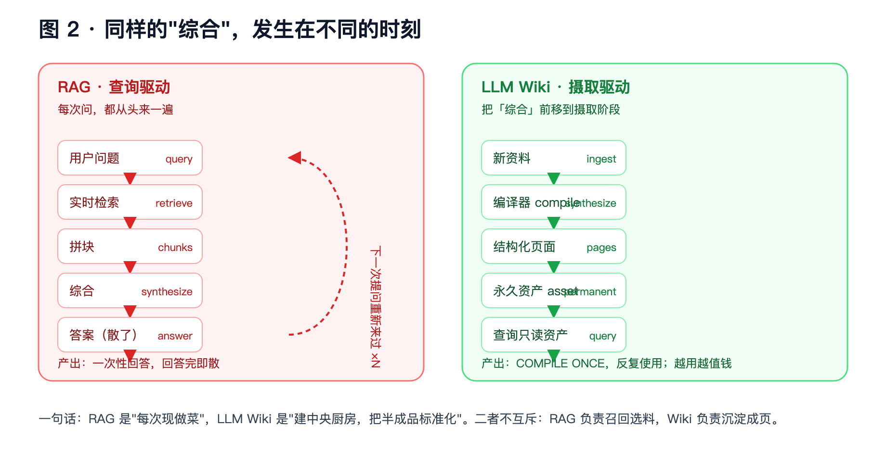

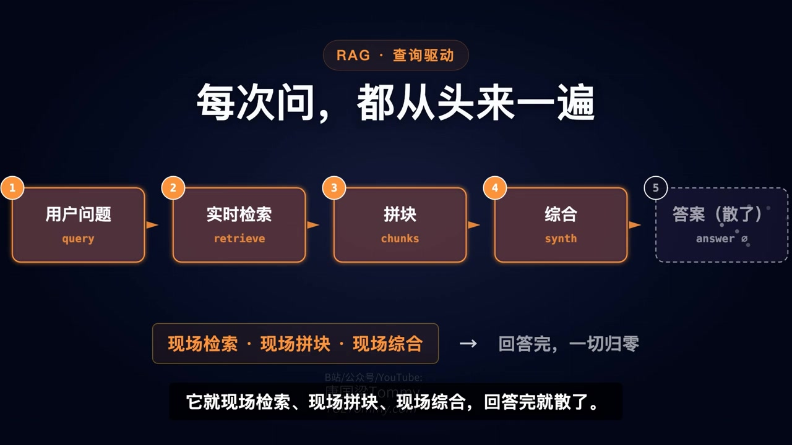

*▲ 视频原帧 k02 · 00:01:00　RAG 查询驱动：现场检索、现场拼块、现场综合，回答完一切归零*

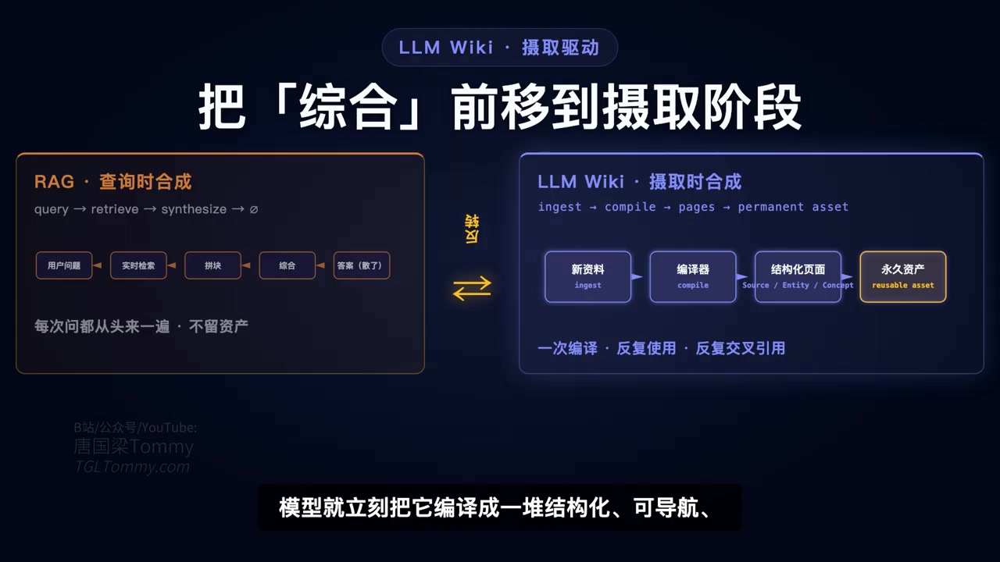

*▲ 视频原帧 k03 · 00:01:20　LLM Wiki 摄取驱动：编译成结构化页面，成为永久资产*


### 1.3 它与 RAG 不是互斥，而是分层协同

- **RAG = 大规模召回层**：向量检索 + BM25，负责从海量原始材料里"捞出相关片段"
- **LLM Wiki = 长期沉淀层**：结构化资产 + 增量编译，负责把"结论"稳定下来
- 实际工作流：**RAG 先帮 Wiki 选料**（判断哪段原始材料值得 ingest），Wiki 负责沉淀成页面

### 1.4 演进主线：RAG → GraphRAG → LLM Wiki

| 时间 | 形态 | 核心贡献 |
|---|---|---|
| 2020 | RAG | 外部知识接入生成 |
| 2024 | GraphRAG | 全局主题抽取、社区发现、实体关系 |
| 2026 | LLM Wiki | 摄取时编译 + 长期资产化 |
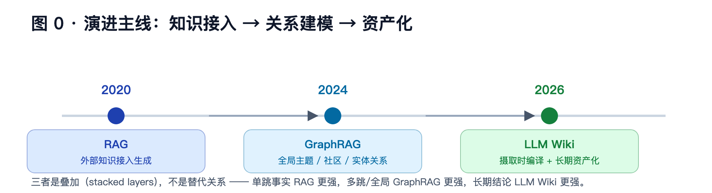


注意：这三者是**叠加（stacked layers）**关系，不是替代关系——见 [8.3](#83-破除误区语料一大就该上-graphrag) 与 [8.4](#84-adaptive-rag按查询类型路由)。

### 1.5 它和三类相邻系统的边界

这三个边界想清楚，你就不会把 LLM Wiki 用歪：

| 对比对象 | 对方是什么 | LLM Wiki 是什么 |
|---|---|---|
| **Agent Memory** | 记**过程**：会话上下文、任务轨迹、踩了什么坑 | 沉淀**结论**：对外可读、可长期维护的知识资产 |
| **Obsidian / Notion（PKM）** | **前端容器**：好的编辑器与浏览体验，本地 Markdown | **后端工作流**：schema 契约 + 编译 + 治理流水线 |
| **知识图谱（Knowledge Graph）** | 节点 + 边的结构化关系网，擅长关系遍历 | 结构化 Markdown + 段落级 provenance，擅长**可读解释与导航** |

> 一句话：Wiki 是"可读的知识产品"，图是"可算的关系骨架"，Memory 是"可续的过程日志"。三者互补。

---

## 2. 为什么需要它：三个现实问题

让 LLM 维护一个 Wiki，Notion AI、Obsidian 插件早就能做。**LLM Wiki 的创新不在"写"，而在于它点破了三个现实问题。**

### 问题一：聊天很强，但默认不留资产

- 第 17 次对话，模型给出一个精彩的技术判断（"你这种读多写少、低冲突的场景，A 方案一致性开销更低"）
- 第 18 次对话，它说："抱歉，我不记得我们之前的对话内容了"
- Chat 流会把好答案冲掉——**滑走即消失**

**解法：好答案必须回写。** 把一次对话里的综合结论，结晶成 Wiki 的一个页面。

### 问题二：传统笔记系统维护成本太高

- 人工要做：建链接、分类、去重、建对比页、发现矛盾
- 而这些恰好是 LLM 最擅长、边际成本趋零的事——**LLM 是天生的"知识文员"**

### 问题三：RAG 每次都在"重新发现"

- 同一份综合判断，Day 1、Day 2、Day 3 每天都要重算一次（检索 ×N、拼块 ×N）
- **解法：COMPILE ONCE —— 一次编译，反复使用**
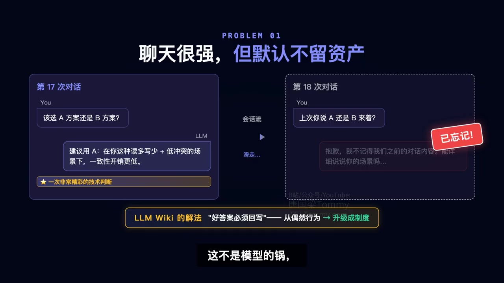

*▲ 视频原帧 k07 · 00:02:46　问题1：聊天不留资产（第 18 次对话已经忘了第 17 次的判断）*

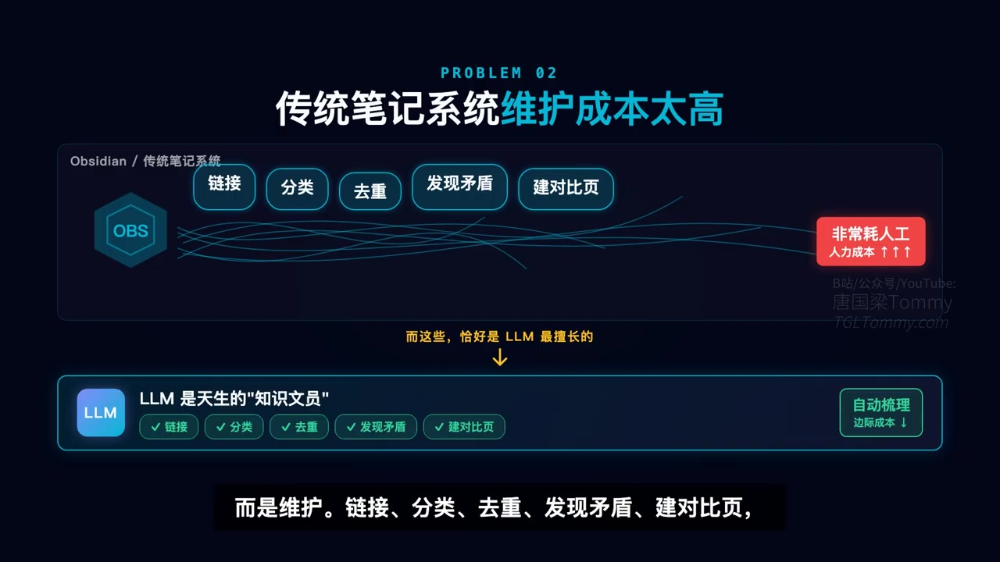

*▲ 视频原帧 k08 · 00:03:10　问题2：传统笔记维护太重，而 LLM 是天生的"知识文员"*

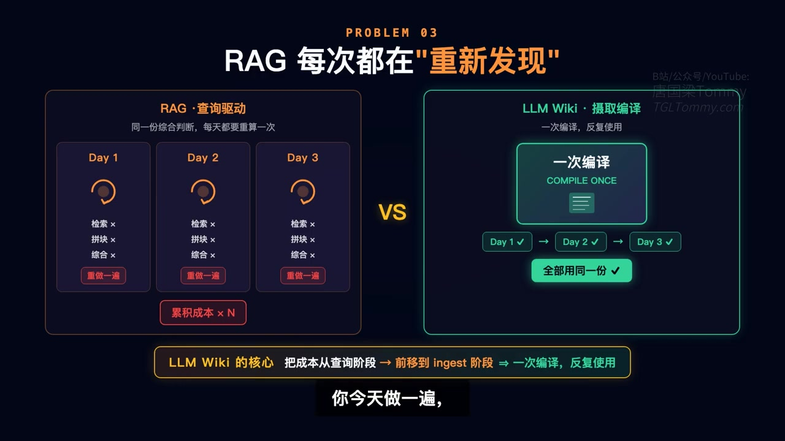

*▲ 视频原帧 k09 · 00:03:25　问题3：RAG 每次都在重新发现，同一份判断每天重算*


---

## 3. 架构：三层 + 控制面

### 3.1 三层结构

```
Layer 3  Schema   行为约束层   规则：谁来写、怎么写、冲突怎么办
Layer 2  Wiki     派生知识层   LLM 消化产出的页面
Layer 1  Raw      原始材料层   PDF / 会议录音 / 网页 / 代码目录，不可变
```

**L1 Raw（不可变）**：一切的证据源。只追加、不改写、不删除。这是事后追溯的唯一依据。

**L2 Wiki（LLM 派生）**：按页面类型组织的结构化知识（概念页、实体页、对比页、综合页、矛盾页……），见第 4 节。

**L3 Schema（行为约束）**：定义"谁负责什么"的规则——**命名规范、新建时机、引用来源、冲突处理**。
四件必须写死的事：
1. 页面怎么命名？
2. 什么时候该开新页（而不是塞进现有页）？
3. 每条结论的证据从哪来、怎么标注？
4. 两条结论矛盾时怎么判？

> 三层不是"三个文件夹"，而是三种**权限**：Raw 只读、Wiki 可写不可随手删、Schema 才是立法机构。
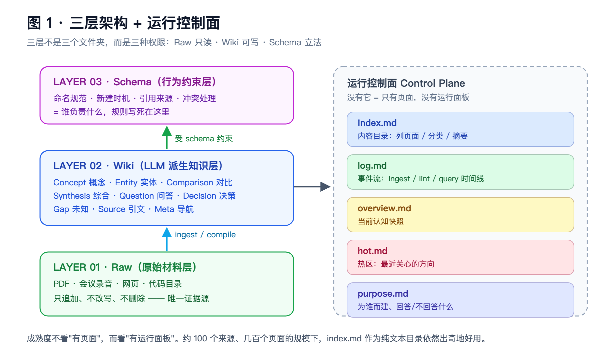

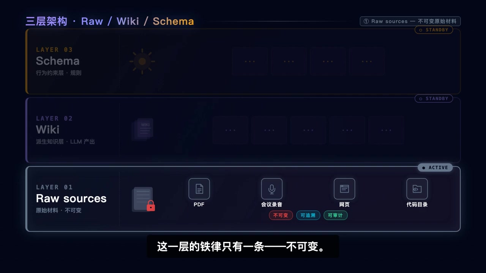

*▲ 视频原帧 k10 · 00:04:00　LAYER 01 Raw：不可变原始材料*

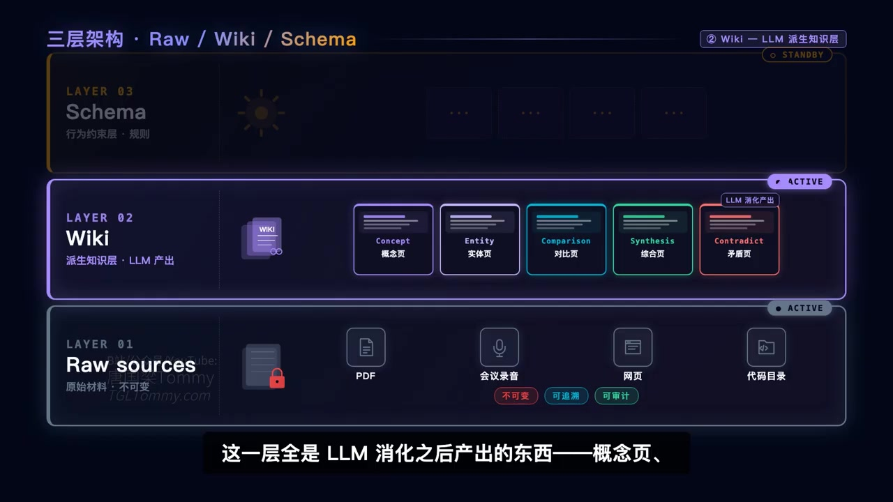

*▲ 视频原帧 k11 · 00:04:20　LAYER 02 Wiki：LLM 派生的知识层*

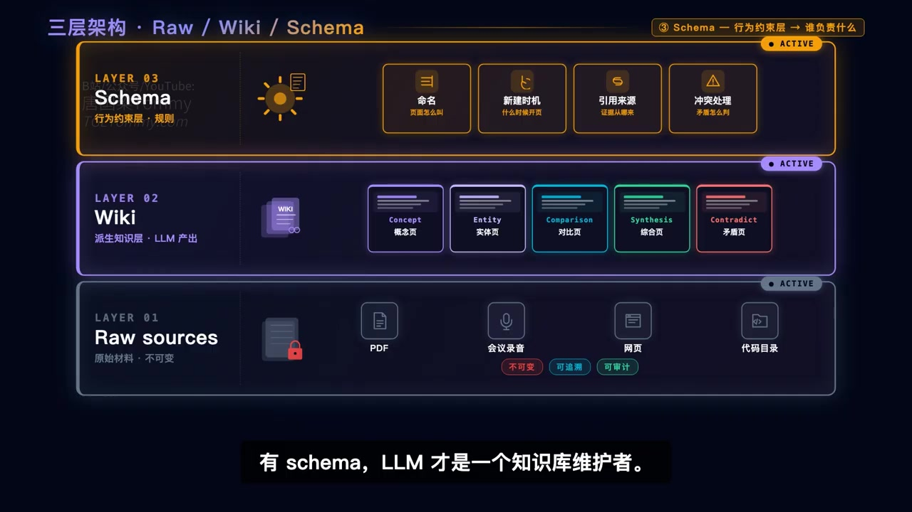

*▲ 视频原帧 k12 · 00:04:44　LAYER 03 Schema：行为约束层，定义谁负责什么*


### 3.2 控制面（Control Plane）

**只有三层还不够。** 成熟实现的共同选择是：在 raw/ 与 wiki/ 之外，长出一组运行控制面。

```
~/wiki
├── raw/            # 原始材料（不可变）
├── wiki/           # 派生页面（LLM 产出）
├── schema/         # 行为约束
├── index.md        # 内容目录：列页面、分类、摘要
├── log.md          # 事件流：ingest / lint / query / conflict 时间线
├── overview.md     # 当前认知快照
├── hot.md          # 热区：最近读者关心的方向
└── purpose.md      # 这个 Wiki 为谁、为什么存在
```

两根最重要的支柱：

| 文件 | 定位 | 内容 |
|---|---|---|
| **index.md** | CONTENT 内容导向 | 所有页面 + 分类 + 一句话摘要 |
| **log.md** | TIMELINE 时间导向 | 每次 ingest / lint / query / conflict 的时间戳与结论 |

**关键判断：成熟度不看"有页面"，而看"有运行面板"。**
在大约 **100 个来源、几百个页面**的规模下，index.md 作为纯文本目录**依然出奇地好用**——不需要一开始就上向量库或图数据库。
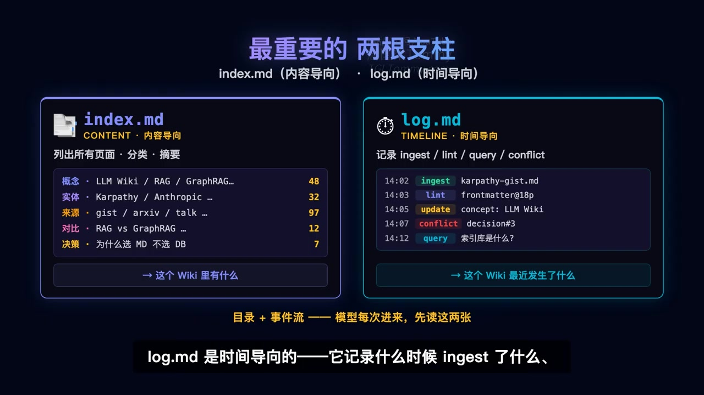

*▲ 视频原帧 k14 · 00:05:25　两根支柱：index.md（内容导向）+ log.md（时间导向）*

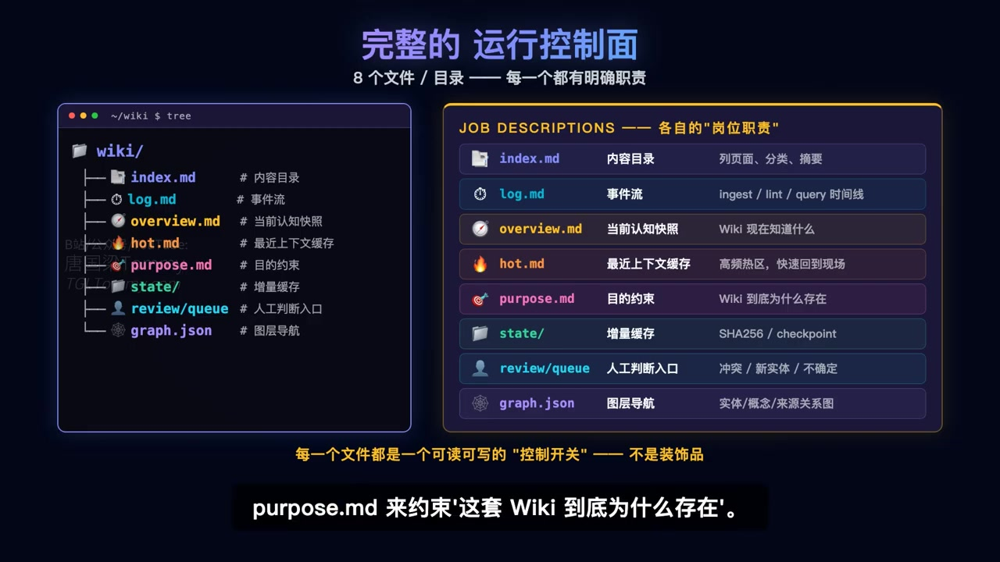

*▲ 视频原帧 k15 · 00:05:46　完整的运行控制面：8 个文件/目录，各有岗位职责*


---

## 4. 知识对象设计：页面类型与元数据

### 4.1 九种常见页面类型

**不能只有"摘要"这一种页面。**

| 类型 | 管什么 | 例子 |
|---|---|---|
| Source | 单篇来源的摘要与出处 | karpathy-gist.md |
| Entity | 人、公司、产品、库 | OpenAI、LangChain |
| Concept | 术语、框架、方法、理论 | RAG、GraphRAG、LLM Wiki |
| Comparison | 横向对比 | RAG vs LLM Wiki |
| Question | 高价值问答的沉淀 | 为什么要 frontmatter？ |
| Synthesis | 跨来源的综合结论 | 2026 知识架构长什么样 |
| Decision | 决策与踩坑经验 | 为什么选 BM25 + vector |
| Gap | 已知的不知道（开放问题） | forgetting 的最佳实践是什么？ |
| Meta | 导航和控制面 | index.md、log.md 本身 |

设计要点：
- **Source 是"引文"，Concept 是"知识"**，二者别混。Source 页回答"这篇说了什么"，Concept 页回答"这件事现在怎么看"。
- **Gap 页最容易被忽略但最有价值**：它把"我不知道什么"显式化，直接喂给 Research 动作（见 7.4）。
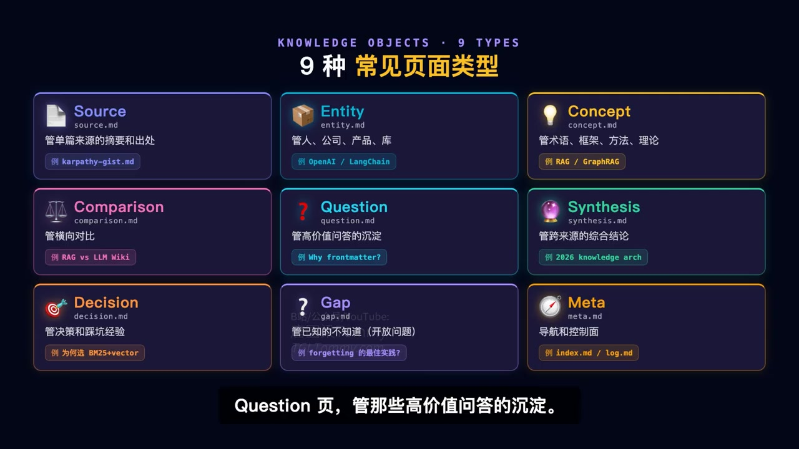

*▲ 视频原帧 k17 · 00:06:46　九种常见页面类型，各有明确的"管什么"*


### 4.2 frontmatter：不是装饰品，是硬约束

每一页都必须有 frontmatter，八个必填字段：

```yaml
---
type: concept              # 类型：source/entity/concept/comparison/question/synthesis/decision/gap/meta
title: LLM Wiki            # 标题
summary: 把综合前移到摄取阶段的知识运行时   # 一句话摘要
sources:                   # 来源（可追溯）
  - karpathy-gist.md
  - atomicmemory.md
tags: [rag, wiki, knowledge]   # 标签
status: verified           # draft / reviewed / verified / stale / superseded
confidence: 0.92           # 结论置信度 0~1
updated: 2026-04-15        # 最后更新时间
---
```

**没有 frontmatter，下面这些都做不到：**
- 按类型过滤（"给我所有 Comparison 页"）
- stale 检测（"哪些页 180 天没更新过"）
- 导出图谱（type + tags + sources → 关系）
- 结构化查询（confidence < 0.6 且 status=verified 的页有哪些）
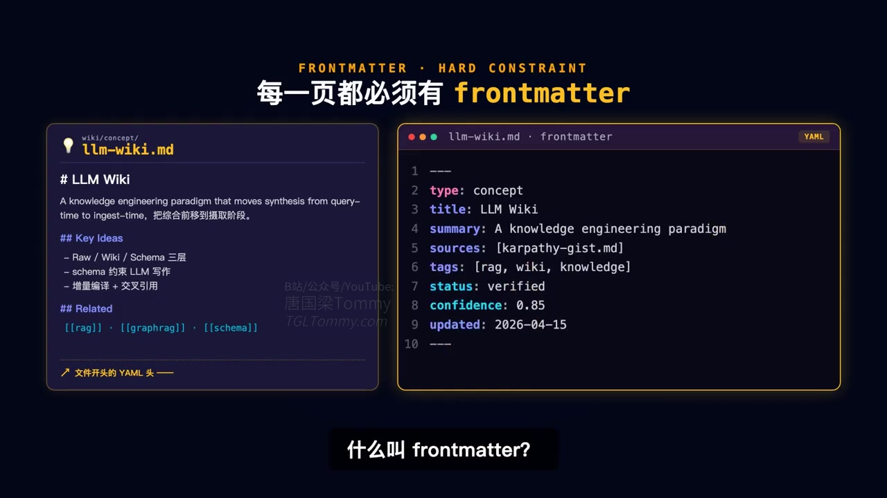

*▲ 视频原帧 k18 · 00:07:10　frontmatter 是硬约束，不是装饰品*

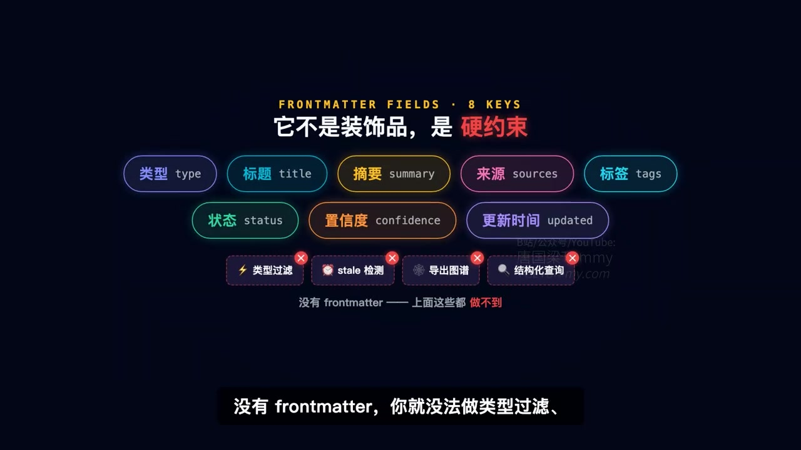

*▲ 视频原帧 k19 · 00:07:24　八个必填字段：type / title / summary / sources / tags / status / confidence / updated*


### 4.3 更激进的实现：再加 4 个字段

一些实现（如 llm-wiki-compiler）会额外加上这四个，做**段落级 provenance**：

```yaml
confidence: 0.92
provenanceState: partial     # full / partial / none —— 来源覆盖状态
contradictedBy:              # 哪些页面反驳了这一页
  - rag-limits-2026.md
inferredParagraphs: [3, 7]   # 哪几段是 LLM 推断，而非原文
```

价值在于：**哪些是抽取、哪些是推断、哪些有争议，全都显式标记。**
这是解决"幻觉回写"（第 10 节）最便宜的一道防线。
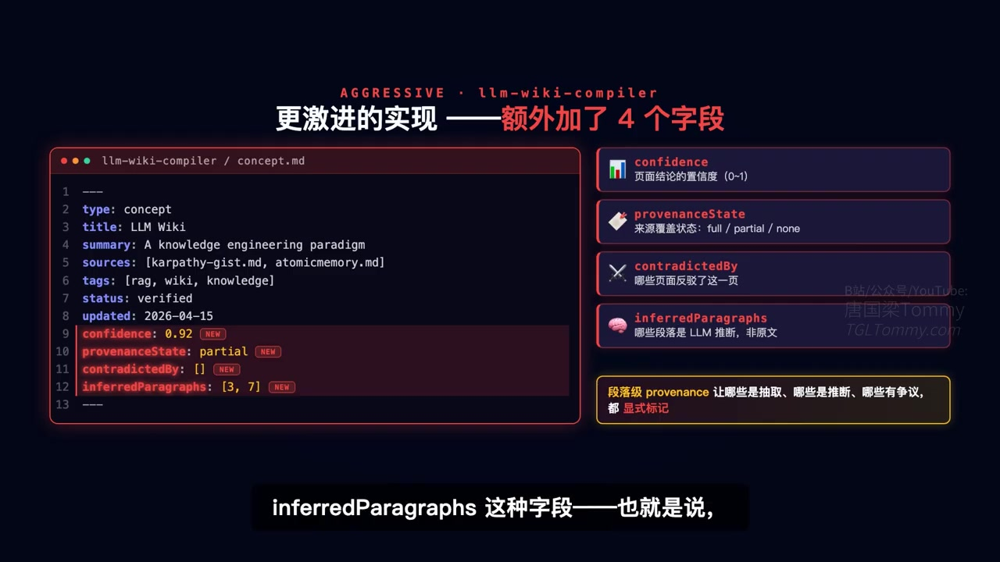

*▲ 视频原帧 k20 · 00:07:38　llm-wiki-compiler 额外四字段：confidence / provenanceState / contradictedBy / inferredParagraphs*


---

## 5. 实战：从零搭一个最小 LLM Wiki

### 5.1 目录结构

```
my-wiki/
├── raw/                          # 原始材料，只增不改
│   └── 2026-04-15-karpathy-gist.md
├── wiki/
│   ├── source/
│   │   └── karpathy-gist.md
│   ├── concept/
│   │   ├── llm-wiki.md
│   │   └── rag.md
│   ├── entity/
│   │   └── openai.md
│   ├── comparison/
│   │   └── rag-vs-llm-wiki.md
│   ├── synthesis/
│   │   └── 2026-knowledge-architecture.md
│   ├── question/
│   ├── decision/
│   ├── gap/
│   └── meta/
├── schema/
│   ├── page-contract.md          # 页面结构契约
│   ├── naming.md                 # 命名规则
│   └── conflict-policy.md        # 冲突判定规则
├── index.md
├── log.md
├── overview.md
├── hot.md
└── purpose.md
```

### 5.2 schema/page-contract.md（示例）

```markdown
# 页面契约

## 命名
- 文件名 = 小写英文 slug + 连字符，如 rag-vs-llm-wiki.md
- 概念页一概念一页；同一概念的别名写进 concept 页正文的"别名"段

## 何时新建页面
- 出现新的**实体**（人/公司/产品/库）→ 新建 entity 页
- 出现新的**术语/方法/理论** → 新建 concept 页
- 两个已有页面被反复对比 → 新建 comparison 页
- 三个以上来源指向同一判断 → 新建 synthesis 页

## 引用来源
- 每条事实性结论后必须跟 [^src]，脚注指向 sources 中的 source 页
- 无来源的句子标记 [inferred]，并写进 frontmatter 的 inferredParagraphs

## 冲突处理
- 两条结论矛盾 → 不删任何一方，新建/更新对比段，标注双方来源与置信度
- 新证据推翻旧结论 → 旧页 status 改 superseded，新页 supersedes 指向旧页
```

### 5.3 五个控制面文件的最小模板

**index.md**
```markdown
# 内容目录

## concept（12）
- [llm-wiki](wiki/concept/llm-wiki.md) — 把综合前移到摄取阶段的知识运行时
- [rag](wiki/concept/rag.md) — 检索增强生成，查询时合成

## comparison（3）
- [rag-vs-llm-wiki](wiki/comparison/rag-vs-llm-wiki.md) — 查询时合成 vs 摄取时编译
```

**log.md**
```markdown
# 事件流

## 2026-04-15 14:02 · ingest
- 源：raw/2026-04-15-karpathy-gist.md
- 触碰页面：llm-wiki.md(更新) · rag.md(更新) · karpathy-gist.md(新建) · log/index(更新)
- review 队列：1 条（confidence 0.62 的推断声明）
```

**hot.md** —— 最近在关心什么（Query 第一步读它，避免全量加载）
```markdown
# 热区

- 主线：LLM Wiki 与 RAG 的分层关系
- 待解：forgetting / retention 机制怎么落地
```

**overview.md** —— 当前认知快照，一段话能讲清"这个 Wiki 现在的结论"
**purpose.md** —— 为谁而建、回答什么问题、不回答什么问题（写清楚这个，能挡掉 80% 的无关 ingest）

### 5.4 一个 concept 页的模板

```yaml
---
type: concept
title: LLM Wiki
summary: 把「综合」从查询时前移到摄取时的知识运行时
sources: [karpathy-gist.md, atomicmemory.md]
tags: [rag, wiki, knowledge-runtime]
status: verified
confidence: 0.9
updated: 2026-04-15
---

# LLM Wiki

## 一句话
LLM 把原始材料编译成结构化页面资产，之后的查询复用资产而不是重算。

## 机制
- 摄取时编译：ingest → compile → pages → permanent asset
- 与 RAG 的关系：RAG 召回层 + Wiki 沉淀层（见 comparison/rag-vs-llm-wiki）

## 证据
- Karpathy gist：wiki 是 persistent, compounding artifact [^src]
- 生产实现：atomicmemory 用 SHA-256 做增量编译 [^src]（推断其动机是省 token [inferred]）

## 未解问题
- 长期 forgetting / retention 的默认参数该怎么设？（见 gap/forgetting-policy）
```

---

## 6. Ingest 管线：八步流水线

### 6.1 扇出效应：1 篇源 → 8 个页面

一次 ingest **不是**"把文章丢进去写个摘要"，它会触达 **8~15 个页面**：

```
new-source.md (新建)
   ├── rag.md                更新（新增一条证据）
   ├── llm-wiki.md           更新
   ├── graphrag.md           更新
   ├── openai.md             更新（entity）
   ├── rag-vs-llm-wiki.md    更新（对比页补一条）
   ├── log.md                追加事件
   └── index.md              目录 +1
```

设计含义：**ingest 必须是事务性的**——要么全部更新成功，要么回滚，否则 index 与正文会不一致。

### 6.2 八步流水线

| 步 | 名称 | 函数 | 做什么 |
|---|---|---|---|
| 1 | 接收原始材料 | ingest_raw() | 落盘到 raw/，记录来源、时间、哈希 |
| 2 | 规范化 | normalize() | 转 Markdown、去噪、保留结构（标题层级） |
| 3 | 读取 schema | load_schema() | 载入页面契约、命名规则、冲突策略 |
| 4 | 分析 pass | analyze() | 抽实体、概念、断言、争议点、待解问题 |
| 5 | 生成 pass | generate() | 按页面契约生成/更新页面草稿 |
| 6 | 交叉引用 pass | cross_ref() | 补双向链接、更新相关页的引用段 |
| 7 | 更新控制面 | update_index() | 更新 index.md、overview.md、hot.md |
| 8 | 进 review 队列 | review_queue() | 高风险/低置信度声明挂起待人审 |

> **每一步都可独立演化、可缓存、可审计。** 这是"八步"而不是"一个大 prompt"的核心原因：
> 单步失败可重试、步骤可跳过、每步产物可对比。
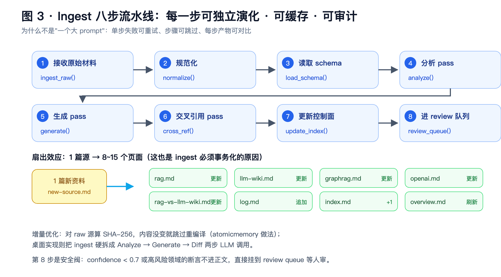

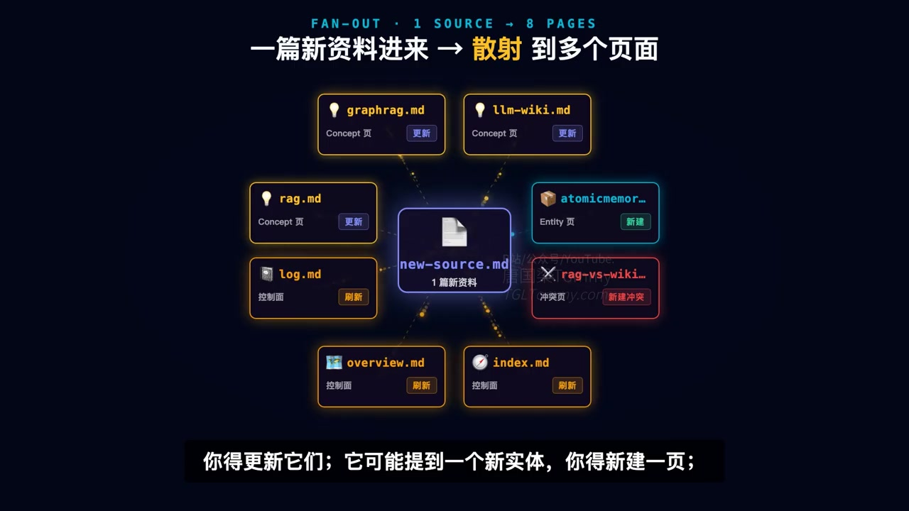

*▲ 视频原帧 k21 · 00:08:20　扇出：1 篇源 → 8 个页面*

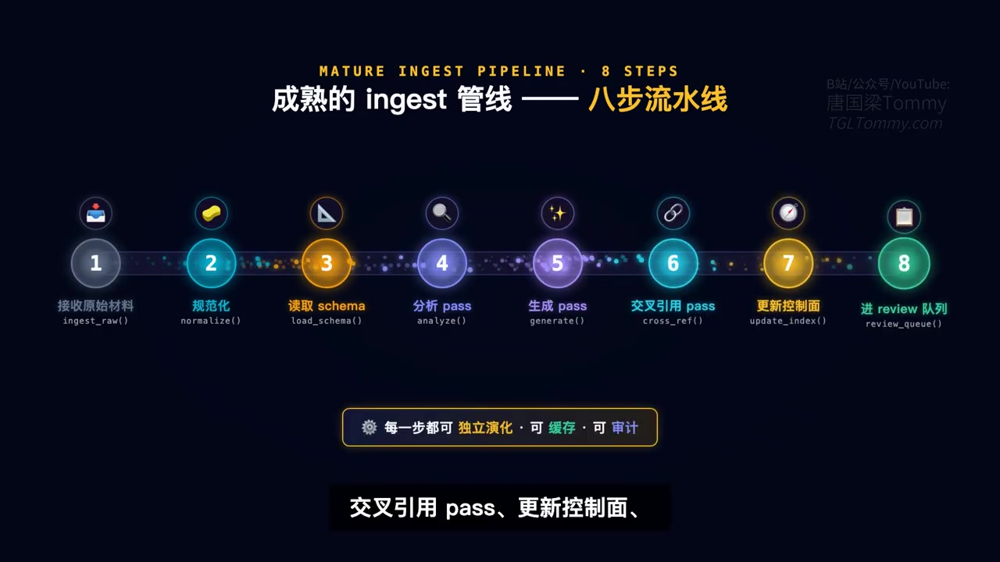

*▲ 视频原帧 k22 · 00:08:39　八步流水线的完整函数名与分工*


### 6.3 两种工程实现

1. **桌面型（硬拆两步 LLM 调用）**：Analyze pass → Generate pass → Diff 落盘。
   好处：分析产物可人工检查；坏处：LLM 调用次数多。
2. **增量化（atomicmemory 风格）**：对 raw 源做 **SHA-256 hash**，内容没变就跳过重编译。
   好处：重复 ingest 几乎零成本；坏处：hash 对"轻微编辑"不敏感，需要配合 diff 层。

### 6.4 ingest 的 prompt 骨架

```
[系统] 你是知识编译器。严格遵守 schema/page-contract.md。
[输入] 新资料全文 + 现有 index.md + 被判定相关的 3~8 个页面全文。
[任务]
1. 抽取：实体、概念、可验证断言（每条带原文出处句）、争议点、待解问题。
2. 判定：哪些已有页面需要更新？是否需要新建页面（依据契约的"何时新建"）？
3. 生成：只输出"更新后的完整页面"或"新建页面"，不要输出解释。
4. 标注：每条断言标 [src] 或 [inferred]；confidence < 0.7 的断言单独列在 PENDING_REVIEW 段。
[输出] JSON：{"updates":[{path, content}], "creates":[{path, content}], "index_delta":[...], "review":[{claim, reason}]}
```

---

## 7. 四个动作让 Wiki 活起来

**Ingest 只是入口。** 让 Wiki 真正活起来的是四个动作：**Query / Save / Lint / Research**（其中 Save 最重要）。
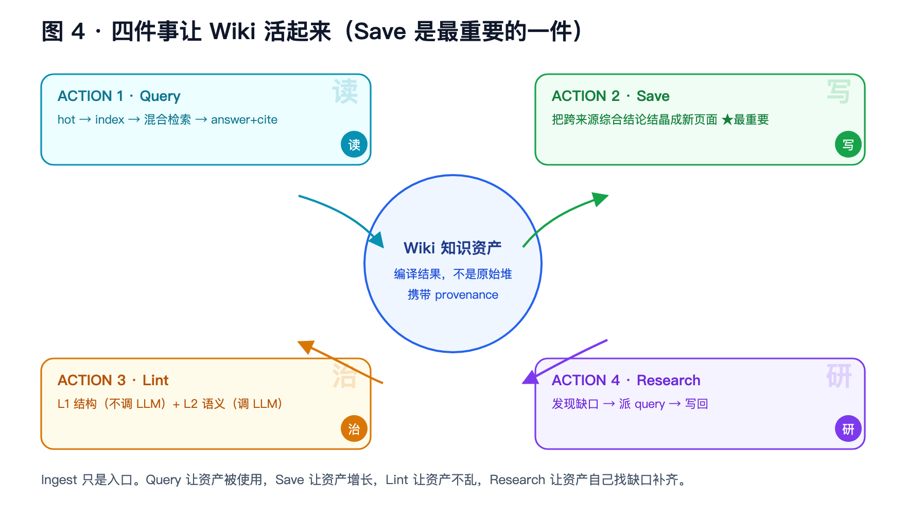


### 7.1 ACTION 1 — Query：查的不是原始文档堆，而是编译结果

五步链路：

| 步 | 动作 | 目的 |
|---|---|---|
| 1 | 读 hot.md | 拿到当前方向（热区） |
| 2 | 读 index.md | 读目录，形成候选集合 |
| 3 | 只读必要页 | 避免全量加载 |
| 4 | hybrid 混合检索 | BM25 + vector + graph |
| 5 | answer + cite | **答案 = 结论 + 溯源** |

> 不是搜 raw，是读 wiki —— 答案自带溯源链路。
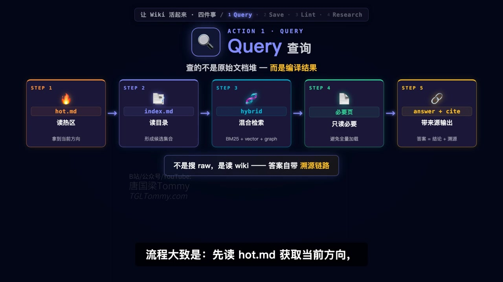

*▲ 视频原帧 k25 · 00:09:30　Query 五步：hot.md → index.md → 只读必要页 → 混合检索 → answer+cite*


**Query prompt 骨架**
```
[输入] 用户问题 + hot.md + index.md
[步骤]
1. 从 index 选出候选页（最多 8 页），说明选择理由。
2. 读候选页，若信息不足，再用 hybrid 检索补 raw 片段。
3. 输出答案，每个结论后跟 [页面路径] 或 [raw 文件:行号]。
4. 如果 Wiki 里没有答案，明确说"没有"，并给出建议 ingest 的材料类型（不是编造）。
```

### 7.2 ACTION 2 — Save 结晶（Crystallization）：四件事里最重要的一件

把一次对话里产生的**跨来源综合结论**，结晶成一个新页面。

```
CHAT：一次对话（"RAG 和 LLM Wiki 到底什么关系？"）
  → Synthesis 页（跨 5 篇来源的综合结论）
  → 写入 wiki/synthesis/ + index.md + log.md
```

判定标准：**这段对话的结论，三个月后还有人会问吗？** 会 → 结晶；不会 → 留在对话里。

这是"聊天不留资产"问题的正面解法，也是 Wiki 越用越值钱的唯一机制。
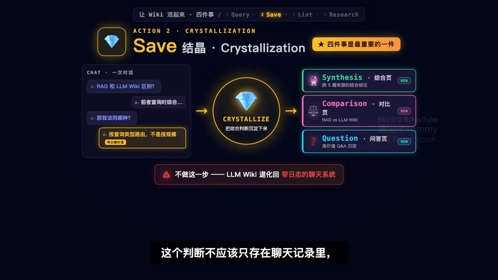

*▲ 视频原帧 k26 · 00:09:51　Save 结晶：把一次对话的综合结论写成 Synthesis 新页面*


### 7.3 ACTION 3 — Lint 治理：分两层

| 层 | 检查项 | 手段 | 成本 |
|---|---|---|---|
| **LAYER 1 结构性** | 死链、孤儿页、空 frontmatter、重复 slug | 规则匹配，**不调 LLM**（health.py） | 便宜，离线可跑，每次提交都跑 |
| **LAYER 2 语义性** | 陈旧声明、冲突结论、可疑推断 | LLM 判断（lint.py） | 贵，定时跑（每日/每周） |

**Layer 1 的实现（可直接抄）**
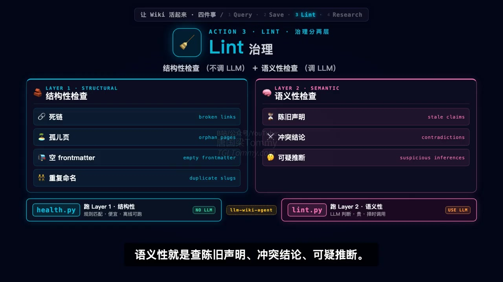

*▲ 视频原帧 k27 · 00:10:18　Lint 两层：结构性（不调 LLM，便宜离线）+ 语义性（调 LLM，贵，择时）*

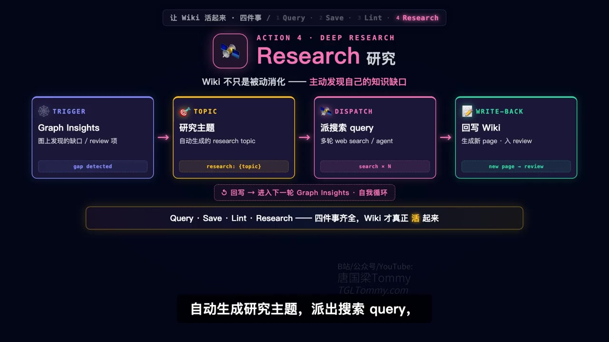

*▲ 视频原帧 k28 · 00:10:42　Research：Topic → Dispatch → Write-back，由 Graph Insights 触发*


```python
import re, pathlib, collections
ROOT = pathlib.Path("wiki")
pages = {p.stem: p for p in ROOT.rglob("*.md")}
probs = collections.defaultdict(list)
seen_slugs = collections.Counter()

for slug, p in pages.items():
    seen_slugs[slug] += 1
    txt = p.read_text(encoding="utf-8")
    m = re.match(r"^---\n(.*?)\n---\n", txt, re.S)
    if not m or "type:" not in m.group(1):
        probs["empty frontmatter"].append(str(p))
    # 死链：[[slug]] 或 (../concept/slug.md)
    for link in re.findall(r"\[\[([^\]]+)\]\]", txt) + re.findall(r"\]\(([^)]+\.md)\)", txt):
        target = pathlib.Path(link).stem
        if target not in pages:
            probs["broken links"].append(f"{p} -> {link}")

# 孤儿页：没有被任何页面引用
inbound = collections.Counter()
for p in pages.values():
    for link in re.findall(r"\[\[([^\]]+)\]\]", p.read_text(encoding="utf-8")):
        inbound[pathlib.Path(link).stem] += 1
for slug in pages:
    if inbound[slug] == 0 and slug != "index":
        probs["orphan pages"].append(slug)

for slug, n in seen_slugs.items():
    if n > 1:
        probs["duplicate slugs"].append(slug)

for k, v in probs.items():
    print(f"{k}: {len(v)}")
    for item in v[:10]:
        print("  -", item)
```

**Layer 2 的检查 prompt**
```
[输入] 一批页面（含 frontmatter 与 sources）
[任务] 只报告三类问题，不要改写内容：
1. 陈旧声明：被更新的 source 推翻但页面未更新的断言
2. 冲突结论：两个页面就同一事实给出不同结论
3. 可疑推断：没有 [src] 且置信度高的断言
[输出] JSON 列表：[{path, problem_type, quote, evidence, suggested_action}]
```

### 7.4 ACTION 4 — Research：主动发现自己的知识缺口

Wiki 不只是被动消化，它应该**主动发现自己的知识缺口**：

```
Graph Insights（从页面关系/覆盖率看图上的洞）
   → 研究主题（Topic）
   → 派搜索 query（Dispatch）
   → 结果可写回 Wiki（Write-back）
```

触发器通常来自三处：Gap 页、低 confidence 页、长时间没更新的 hot 主题。

---

## 8. 进阶：检索融合与抗偏差

### 8.1 三路信号融合：BM25 + vector + graph

单一召回总有盲区：BM25 强在词法精确匹配，vector 强在语义泛化，graph 强在关系跳转。
社区较为一致的做法是**三路并行召回 + RRF 融合**：

```python
def rrf(rank_lists, k=60):
    """Reciprocal Rank Fusion：对每个文档在各路排名取倒数和"""
    score = {}
    for ranks in rank_lists:
        for i, doc in enumerate(ranks, 1):
            score[doc] = score.get(doc, 0.0) + 1.0 / (k + i)
    return sorted(score, key=score.get, reverse=True)

top = rrf([bm25_results, vector_results, graph_results])
```

RRF 的好处：不需要调权重、对不同分数量纲鲁棒、实现十行内。
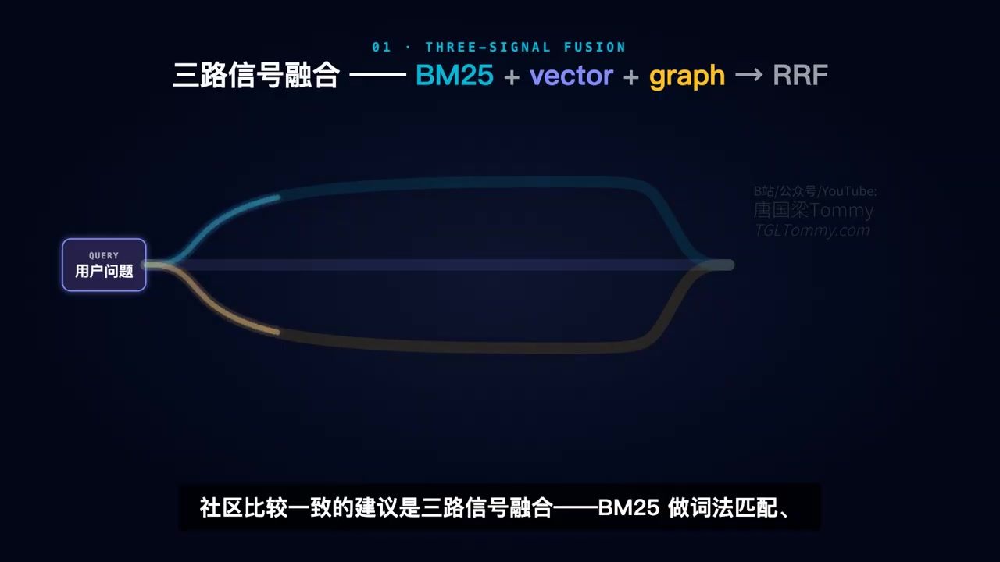

*▲ 视频原帧 k33 · 00:12:22　三路信号融合：BM25 + vector + graph，用 RRF 合并*


### 8.2 破除误区："语料一大就该上 GraphRAG"

GraphRAG-Bench 的冷静结论：

| 任务类型 | 谁更强 |
|---|---|
| 多跳推理（multi-hop reasoning） | **GraphRAG** |
| 跨实体关联（cross-entity association） | **GraphRAG** |
| 全局综合（global sensemaking） | **GraphRAG** |
| **单跳事实检索（single-hop factual）** | **vanilla RAG**（更简洁高效） |

> **不是越复杂越好，按任务类型选架构。**
> 一上来就建图，很可能在 80% 的查询上花掉 3 倍成本换来更差的答案。
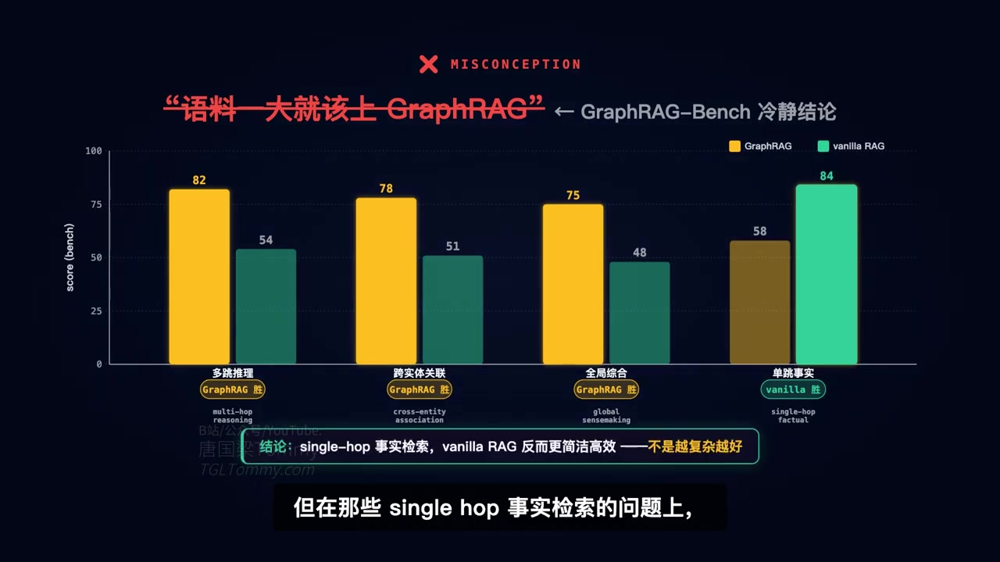

*▲ 视频原帧 k34 · 00:12:56　GraphRAG-Bench：多跳/跨实体/全局综合 GraphRAG 胜，单跳事实 vanilla RAG 反而更简洁*


### 8.3 Adaptive RAG：按查询类型路由

思路：先用一个 **Query Classifier** 判断问题类型，再决定走哪条管线。

判断维度：
- hop_count：单跳 / 多跳
- entity_breadth：涉及几个实体
- scope：local / global

```
"VeRL 的作者是谁？"                    → single-hop     → vanilla RAG
"GRPO 和 PPO 在梯度估计上的差异？"      → multi-hop      → GraphRAG / 图检索
"综述当前开源 RLHF 生态"               → topic synthesis → LLM Wiki 综合页
```

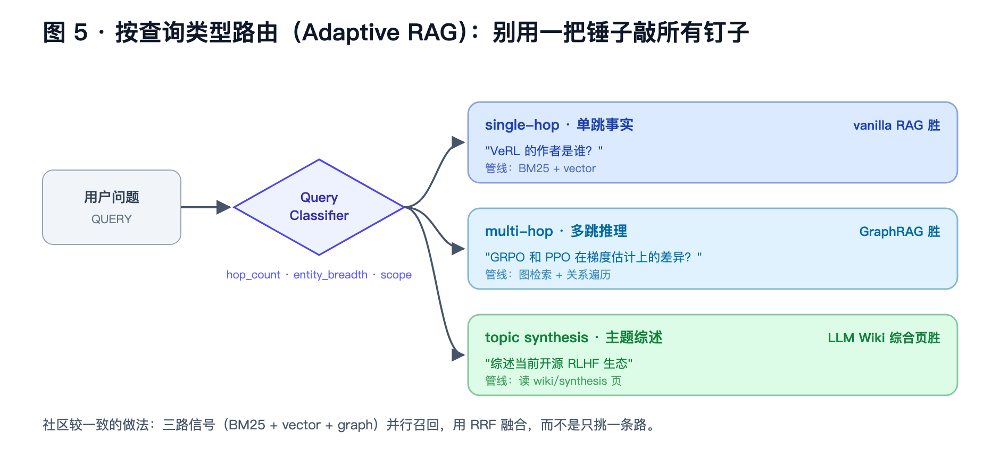

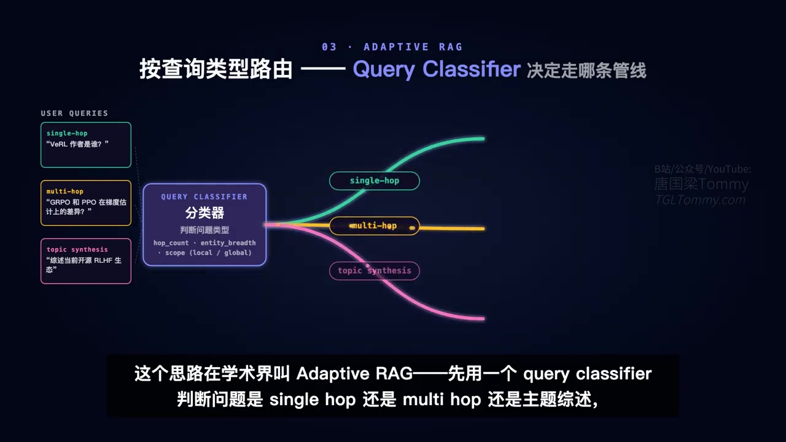

*▲ 视频原帧 k35 · 00:13:09　Query Classifier：用 hop_count / entity_breadth / scope 判断走哪条管线*

### 8.4 并发视角：多路 ingest 抗"确认偏差"

**串行单视角的最大问题**：一篇资料 → 单个 LLM 读一遍写一遍 → 一页结论。
上游的一个可疑断言被直接写成事实，错误顺着下游页面一直往下长（见 10.2）。

两种解法：

**(a) 多视角并行 ingest**：同一主题分学术、技术、应用、新闻（GitHub / blogs / case studies / 新闻）多路并行 ingest，冲突留给 Lint 阶段处理。

**(b) Thesis Mode（针对有争议命题）**：派 5 个立场分化的 agent 并行取证——

| 角色 | 职责 |
|---|---|
| Supporter 支持方 | 找引用、找复现 |
| Opposer 反对方 | 找反例、找驳斥 |
| Mechanist 机制派 | 走因果、走推导 |
| Meta-review 元综述派 | 做综述、做横向 |
| Cross-domain 相关领域派 | 做类比、做迁移 |

**代价 vs 价值**：每多 1 个 agent，token 和延迟都 ×N（5~10 个 agent 并行，成本翻几倍）；
换取的是**破除共识偏差、真正可靠的结论**。所以它只对**高风险结论**（医疗 / 法律 / 金融 / 安全，错了代价极高）开火。

### 8.5 共存而非替代

```
        ┌─────────────────────────────┐
        │  LLM Wiki  · 知识资产层      │  综述 / 长期结论 / 版本化
        ├─────────────────────────────┤
        │  GraphRAG  · 关系图检索层    │  多跳 / 跨实体关联
        ├─────────────────────────────┤
        │  vanilla RAG · 词法+语义层   │  单跳事实 / 高频查询
        └─────────────────────────────┘
```

---

## 9. 治理：生命周期、健康度、置信度

### 9.1 生命周期：旧知识不删除，而是降权

```
confidence
1.00 ┤ ● verified   被持续验证 → 保持高位
0.75 ┤   ╲
0.50 ┤    ╲● stale  没人访问 → 缓慢下降
0.25 ┤      ╲╲
0.00 ┤        ╲● superseded  新证据覆盖 → 急速降权
     └──┬────┬────┬────┬────┬────→
       0d  90d  180d 270d 365d   time
```

三条原则：
1. **不物理删除**（删除就丢了"曾经这么认为"的审计价值）
2. **旧版本标 SUPERSEDED，但保留可查**
3. **长时间没被重新验证的，自动降权**
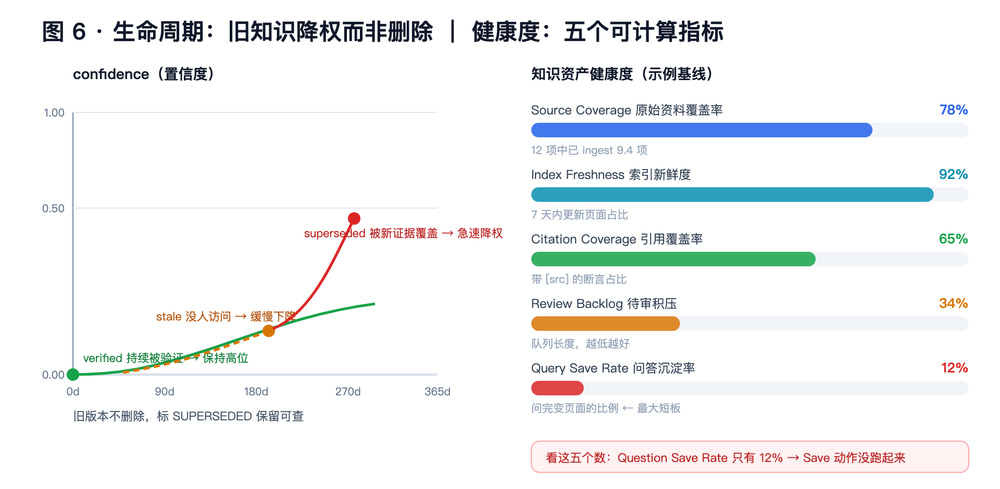

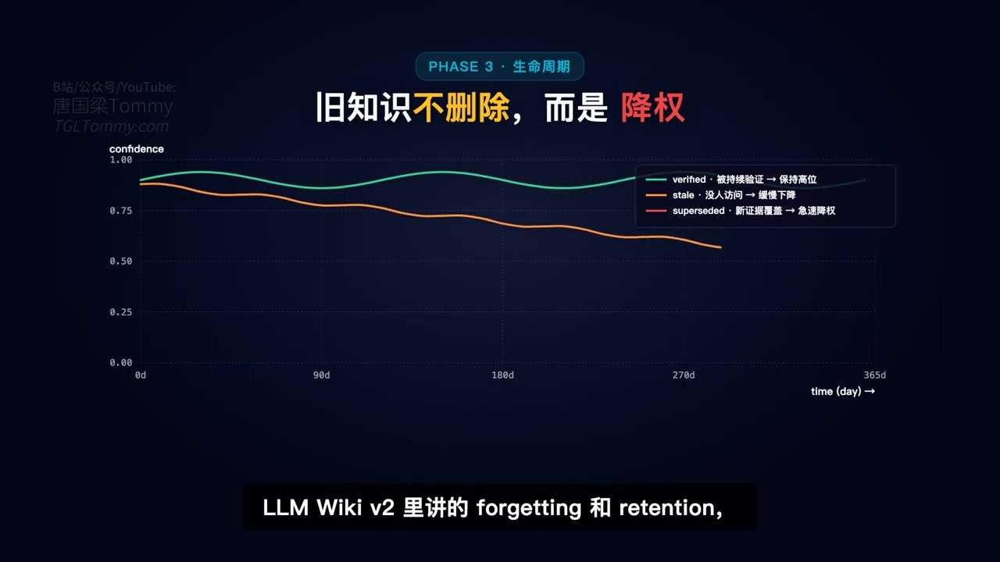

*▲ 视频原帧 k43 · 00:15:06　三条曲线：verified 保持高位 / stale 缓慢下降 / superseded 急速降权*

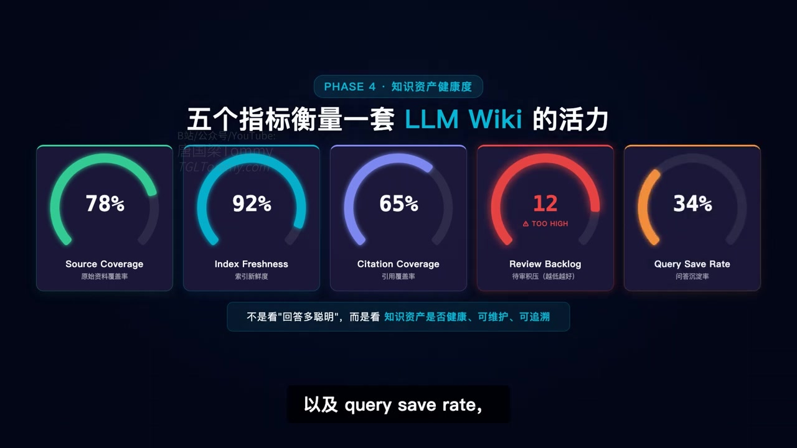

*▲ 视频原帧 k44 · 00:15:35　健康度五指标：78% / 92% / 65% / 34% / 12%*


### 9.2 知识资产健康度：五个指标

不要看"回答多聪明"，要看**知识资产是否健康、可维护、可追溯**。

| 指标 | 含义 | 计算方式 | 健康值参考 |
|---|---|---|---|
| Source Coverage 原始资料覆盖率 | 有多少 raw 源已被 ingest | 已 ingest 源 / raw 总数 | 78% |
| Index Freshness 索引新鲜度 | 索引是否及时更新 | 7 天内更新页面 / 总页面 | 92% |
| Citation Coverage 引用覆盖率 | 断言里带 [src] 的比例 | 带引用的断言 / 总断言 | 65% |
| Review Backlog 待审积压 | 待人工复核的声明数 | 队列长度（**越低越好**） | 34% |
| Query Save Rate 问答沉淀率 | 问了之后有多少变成页面 | 新增页面 / 查询次数 | 12% |

> 这五个数一摆出来，问题立刻清楚：**Query Save Rate 只有 12%，说明这套 Wiki 主要还在被"读"，没有被"沉淀"——Save 动作没跑起来。**

### 9.3 核心治理：两个机制决定 Wiki 能否长期活下去

**① Confidence 置信度**
- 新来源、多来源支持 → 更可信
- 长时间没被重新验证 → 自动降权

**② Supersession 取代机制**
```
page v1  2025-04  原始事实     → SUPERSEDED
page v2  2025-10  中间版本     → SUPERSEDED / STALE
page v3  2026-04  当前事实     → CURRENT, supersedes: [page-v1, page-v2]
```

> **危险的不是"有矛盾"，而是旧信息以当前事实的姿态存在。**
> **难点不是生成，是治理。**
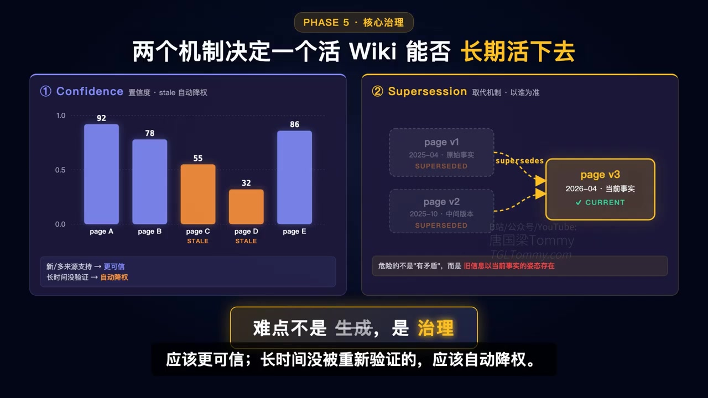

*▲ 视频原帧 k45 · 00:15:56　confidence + supersession：v1 原始事实 → v2 中间版本 STALE → v3 当前事实 CURRENT*


---

## 10. 风险与根治方案

### 10.1 最致命的写入闭环：幻觉回写

```
LLM ingest 写入/更新页面
   → 保存过的页面被下一次 ingest 读作"背景知识"
      → 作为"事实"继续扩展
         → 再写入
            → 一次幻觉保存 = 永远在闭环中自我放大
```

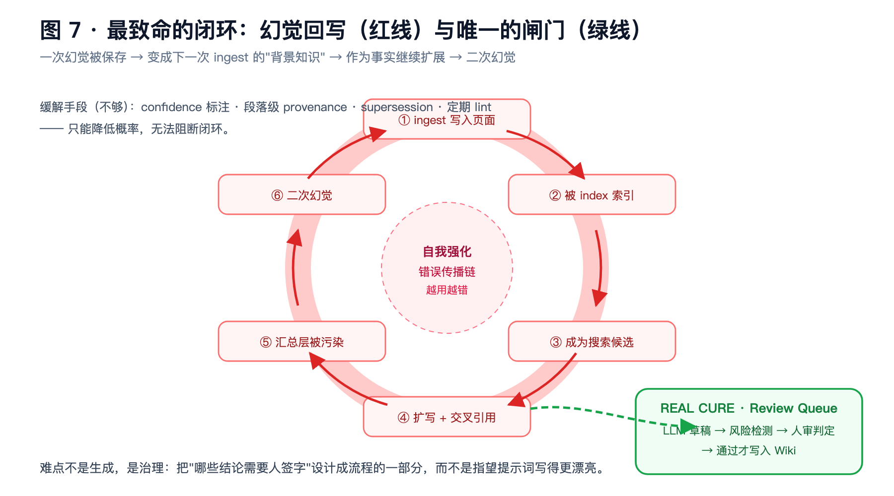

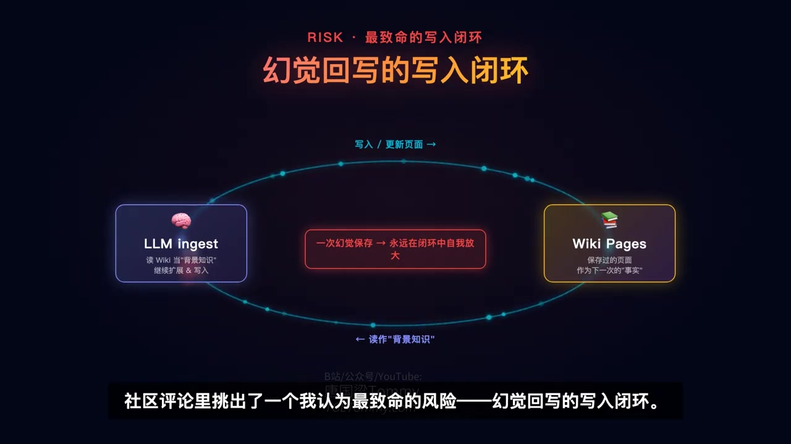

*▲ 视频原帧 k46 · 00:16:22　幻觉回写的写入闭环：保存过的页面变成下一次的"事实"*

### 10.2 错误传播链

```
一条幻觉声明
  → 写入 Wiki 页面
    → 被 index 索引 → 成为搜索候选
      → 被扩展引用 / 交叉链接
        → 触发新冲突页 / 连到其他 entity
          → 汇总层被污染 → 逼出对立结论 → 二次幻觉
```

### 10.3 三个衍生结构性问题

1. **部分上下文**：一次 ingest 只看 index + 少量相关页，不是整本 wiki —— 模型在不知情状态下改动
2. **信息损失**：摘要化会压掉细粒度条件、例外、限定语
3. **去 provenance 化**：生成页不带原句引用，事后发现有疑问根本无法回溯

### 10.4 缓解 ≠ 根治

| 只是缓解（ONLY MITIGATE） | 真正的解法（THE REAL CURE） |
|---|---|
| Confidence 标注 | **高风险声明主动进 Review Queue** |
| 段落级 provenance | LLM 草稿 → 风险检测 → **人审判定** → 写入 Wiki |
| Supersession | 让人来判，而不是指望 LLM 在 ingest 当场写对 |
| 定期 Lint | 降低概率，但无法阻断闭环 |

**结论：把"哪些结论需要人签字"设计成流程的一部分，而不是期望提示词写得更好。**
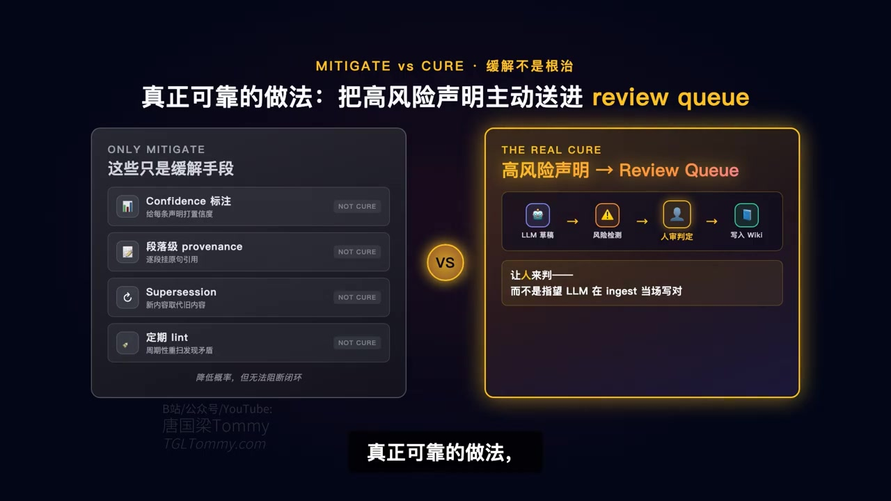

*▲ 视频原帧 k49 · 00:17:28　缓解 vs 根治：高风险声明 → Review Queue → 人审判定 → 才写入*


### 10.5 成本迁移：维护成本不会消失，只是搬家

| 传统维护（人工） | LLM Wiki 维护（机器工作流） |
|---|---|
| 写笔记 | 维护 schema |
| 整理链接 | 维护索引 |
| 审 review | 看 Lint 报告 |

人力从"抄写整理"迁移到"治理与审核"。**这也是为什么 Save 与 Review 必须由人来把关：人的价值从执行转到了判断。**

---

## 11. 适用与不适用场景

### 11.1 特别适合的六类场景

共同特征：**资料会不断进来，结论需要被反复查阅和再加工。**

1. **长期主题研究** —— 资料持续进来，结论需要版本化沉淀
2. **论文精读** —— 逐篇 ingest，交叉引用与对比综合
3. **代码库理解** —— 模块、接口、调用关系的结构化记忆
4. **竞品情报** —— 多家产品的特性 / 价格 / 变更轨迹
5. **个人第二大脑** —— 跨领域笔记 + LLM 辅助维护与检索
6. **多代理共享上下文** —— 多 agent 对同一份 Wiki 读写协作

### 11.2 不该硬上的场景

| 场景 | 更合适的方案 | 原因 |
|---|---|---|
| 一次性问答 | 直接 Chat | 没必要为单次问题架一整套治理层 |
| 大规模低价值语料粗筛 | 先上 RAG | 海量长尾素材，单位价值低 |
| 实时监控告警 | 观测系统 | 秒级事件流，不是知识沉淀 |

### 11.3 最终的角色定位

让每一次 ingest / query / research，都变成对**同一份知识资产**的增量投资：

| 组件 | 角色 |
|---|---|
| LLM | 编译器 Compiler |
| Chat | 入口 Entry Point |
| Wiki | 产品 Product |
| Graph | 导航层 Navigation |
| Schema | 操作系统 OS |
| Review | 刹车 Brake |
| Log | 审计轨迹 Audit Trail |

> **聊天是入口，Wiki 才是产品 —— 一个会越用越值钱的知识运行时。**
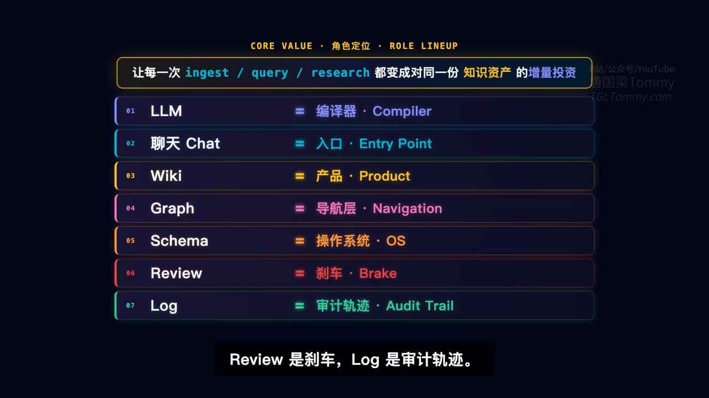

*▲ 视频原帧 k53 · 00:18:50　角色定位：LLM=编译器 · Chat=入口 · Wiki=产品 · Graph=导航 · Schema=OS · Review=刹车 · Log=审计*


---

## 12. 30 天落地路线图

| 周 | 目标 | 交付物 | 验收标准 |
|---|---|---|---|
| 第 1 周 | 立规矩 | purpose.md、schema/page-contract.md、五份控制面文件、目录骨架 | 能说清"这个 Wiki 为谁服务、不服务什么" |
| 第 2 周 | 跑通 ingest | 八步管线（前 5 步即可）、20 篇源、index 自动更新 | 一篇新资料能正确触达 5+ 页面且不断链 |
| 第 3 周 | 让资产流动 | Query 五步链路、Save 结晶动作、Layer 1 Lint 脚本 | Query Save Rate > 20%，死链 = 0 |
| 第 4 周 | 上治理 | Layer 2 语义 Lint、confidence/supersession、review queue（哪怕只有 1 人） | 五个健康度指标能算出来，且 Review Backlog 在下降 |

**别做的事（前 30 天）**：不要建图数据库、不要写向量服务、不要做自定义 UI。
index.md + grep + 一个 LLM 就够了——这正是"100 个来源、几百个页面"规模下 index.md 依然好用的原因。

---

## 13. 踩坑清单

- [ ] **把 LLM Wiki 当成"RAG 加个向量库"** —— 那只是更贵的 RAG，没有解决"重算"问题
- [ ] **没有 schema 就开写** —— 三个月后页面结构各不相同，无法结构化查询
- [ ] **frontmatter 可有可无** —— 类型过滤、stale 检测、图谱导出全部失效
- [ ] **ingest 只写新页，不更新旧页** —— 扇出没做，Wiki 退化成"摘要仓库"
- [ ] **只 Query 不 Save** —— Query Save Rate 长期 < 10%，资产不会复利
- [ ] **Lint 只做结构层** —— 死链能查出来，陈旧的错误结论查不出来
- [ ] **摘要化吃掉限定语** —— "在低冲突场景下"被删成"建议用 A 方案"，这是信息损失
- [ ] **生成页不留原句引用** —— 出事时无法回溯
- [ ] **让人信任自动写入** —— 高风险声明必须进 review queue，没有例外
- [ ] **一上来就建图 / 上分布式** —— 单跳事实检索上 GraphRAG 反而更差
- [ ] **删除旧知识** —— 应该降权（superseded），而不是删除
- [ ] **没有 purpose.md** —— ingest 范围无限膨胀，信噪比崩掉

---

## 14. 术语表

| 术语 | 含义 |
|---|---|
| **摄取时综合（synthesis at ingest）** | 综合发生在资料进来时，而非用户提问时 |
| **扇出（fan-out）** | 一篇源触发多个页面更新 |
| **控制面（Control Plane）** | index / log / overview / hot / purpose 等运行期文件 |
| **结晶（Crystallization）** | 把对话中的综合结论写成新页面（Save 动作） |
| **provenance** | 溯源：每条结论能追到具体来源与原句 |
| **supersession** | 新结论取代旧结论的机制，旧页标记但保留 |
| **确认偏差（confirmation bias）** | 单一视角 ingest 导致只收集支持既有结论的证据 |
| **RRF** | Reciprocal Rank Fusion，多路召回结果融合算法 |
| **Adaptive RAG** | 按查询类型路由到不同检索管线的策略 |
| **stale / superseded** | 陈旧（久未验证） / 已被取代的页面状态 |

---

## 附录：与本教程对应的视频章节

| 章节 | 视频时间码 | 关键帧 |
|---|---|---|
| 1 核心概念 | 00:01:00 – 00:02:06 | k02–k05 |
| 2 三个现实问题 | 00:02:27 – 00:03:25 | k06–k09 |
| 3 三层 + 控制面 | 00:04:00 – 00:06:08 | k10–k16 |
| 4 页面类型与元数据 | 00:06:46 – 00:07:38 | k17–k20 |
| 6 Ingest 管线 | 00:08:20 – 00:08:58 | k21–k23 |
| 7 四个动作 | 00:09:19 – 00:10:42 | k24–k28 |
| 8 检索与抗偏差 | 00:11:04 – 00:13:20 | k29–k36 |
| 9 边界对比 | 00:13:30 – 00:14:18 | k37–k40 |
| 9 五阶段治理 | 00:14:32 – 00:15:56 | k41–k45 |
| 10 风险与根治 | 00:16:22 – 00:17:45 | k46–k50 |
| 11 适用性 | 00:18:01 – 00:18:50 | k51–k53 |
