# 多模态原理：从声波到语义，一台 AI 如何"听懂"你说话

> 本文基于 B 站视频《语音识别天花板？一期视频讲透 Fun-ASR 的诞生与核心原理》（BV1XAbd6SEnJ，2026 年 8 月发布，18 分钟）整理，
> 并补齐了 2026 年 11 月时点上的最新公开资料：Fun-ASR 技术报告（arXiv:2509.12508）、Fun-ASR-Nano-2512 开源模型说明、Paraformer / Conformer / FunASR 原始论文。
> 读完你应当能：① 用一句话讲清"语音 → 文字"的四步通用链路；② 理解每步为什么这样做、以及常见误区；③ 分清 FunASR（工具包）与 Fun-ASR（2025 年大模型）的关系；④ 知道 2026 年多模态语音的主流范式与选型口诀。

---

## 目录

1. [先讲结论：多模态有一张"四步通用地图"](#1-先讲结论多模态有一张四步通用地图)
2. [视频速览：18 分钟讲了什么](#2-视频速览18-分钟讲了什么)
3. [背景：为什么说传统语音识别"链路长、成本高、速度慢"](#3-背景为什么说传统语音识别链路长成本高速度慢)
4. [解药：FunASR 与 Paraformer 到底是什么](#4-解药funasr-与-paraformer-到底是什么)
5. [原理一：波形 → 梅尔谱，把声音变成一张可以计算的"照片"](#5-原理一波形--梅尔谱把声音变成一张可以计算的照片)
6. [原理二：梅尔谱 → 深层声学特征，CNN 抠细节、注意力抓全局](#6-原理二梅尔谱--深层声学特征cnn-抠细节注意力抓全局)
7. [原理三：长声学序列 → 短语义块，解决"50 帧对 4 个字"的长度矛盾](#7-原理三长声学序列--短语义块解决50-帧对-4-个字的长度矛盾)
8. [原理四：语义块 → 文字，非自回归解码与 Glancing LM](#8-原理四语义块--文字非自回归解码与-glancing-lm)
9. [视频结论，以及这个结论的边界](#9-视频结论以及这个结论的边界)
10. [视频之外：2026 的主流答案——LLM-ASR 与原生多模态](#10-视频之外2026-的主流答案llm-asr-与原生多模态)
11. [从语音到全模态：三条路线与一张全景图](#11-从语音到全模态三条路线与一张全景图)
12. [动手：两套最小可跑示例](#12-动手两套最小可跑示例)
13. [尽职调查清单：视频没讲、但部署前必须知道的坑](#13-尽职调查清单视频没讲但部署前必须知道的坑)
14. [术语表](#14-术语表)
15. [参考与延伸](#15-参考与延伸)

### 图解索引

| 图 | 主题 | 类型 |
|---|---|---|
| 图 1 | 多模态的通用四步：编码 → 对齐 → 融合 → 生成 | 自绘 |
| 图 2 | Fun-ASR 原理四步全链路 | 自绘 |
| 图 3 | 语音识别范式演进（1990s → 2026） | 自绘 |
| 图 4 | 声学 + 语义双通道如何消歧"世界 / 视界" | 自绘 |
| 图 5 | Fun-ASR（LLM-ASR）端到端架构 | 自绘 |
| 图 6 | 三条主流路线：级联 / LLM-ASR / 原生全模态 | 自绘 |

另有 **14 张视频原帧**（均带帧号与时间码），穿插在各章节，对照原片核验使用。

---

## 1. 先讲结论：多模态有一张"四步通用地图"

无论你的模型是"语音转文字"（ASR）、"图片问答"（VQA），还是"看视频写摘要"，底层都是一套相差无几的流水线：

**① 编码（Encode）→ ② 对齐（Align）→ ③ 融合（Fuse）→ ④ 生成（Generate）**

- **编码**：把原始信号（声波、像素、token）变成神经网络能计算的数字矩阵，且不同模态各有"特化编码器"——音频用梅尔谱 + 卷积，图像用 ViT 切 patch，文本用 embedding 查表；
- **对齐**：把不同模态变长、变短、不同步的信息，映射到同一个语义空间、同一套时间轴上；
- **融合**：用 Transformer + LLM 把多路信息"读懂"，形成统一的语义表示；
- **生成**：自回归（或非自回归）地输出目标模态——文字、语音、动作、甚至另一张图。

语音识别恰好是这张地图上"最短、最干净"的一条线：只有音频与文本两个模态，但四步一个不少。**把 ASR 讲透，多模态剩下的只是"把编码器换成另一个"。** 这也是我们选这个视频作为切入点的原因。

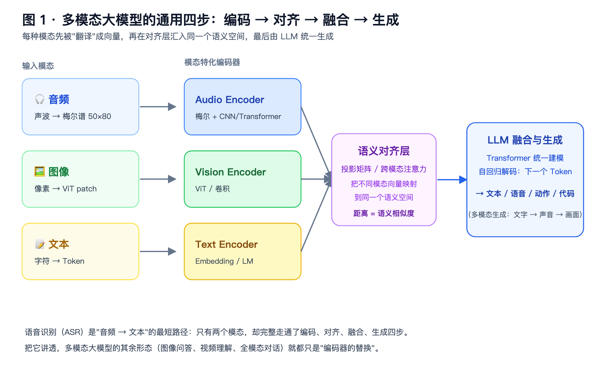

*▲ 图 1 自绘。同一套流水线，换掉"模态特化编码器"就变成另一种多模态任务。*

---

## 2. 视频速览：18 分钟讲了什么

视频 UP 主是 B 站的「乐茵linn」。它的价值在于：**用最直白的中文，把"声音怎么变成文字"拆成四步**，并配了完整的动画演示。结构如下：

| 部分 | 时间线 | 讲了什么 | 核心主张 |
|---|---|---|---|
| PART ONE 背景 | 00:54 – 03:04 | 传统 Kaldi 的三段式痛点、FunASR 的解法 | 链路长、成本高、速度慢 → 端到端 + 非自回归 |
| PART TWO 介绍 & 特点 | 03:04 – 05:12 | FunASR 是什么、五个卖点、时间线 | Paraformer 是"工业级非自回归"的技术底座 |
| PART THREE 原理 | 05:12 – 16:00 | 四步拆解：梅尔谱 → 声学特征 → 对齐 → 解码 | 每一步解决一个"信息形态"问题 |
| PART FOUR 总结 | 16:00 – 18:01 | 核心贡献归纳 | 打破"高精度 vs 高延迟"不可兼得 |

> **一个必须先说的澄清**：视频标题写的是"Fun-ASR"，但通篇讲的是 **FunASR 工具包**（2022–2024 年，核心为 Paraformer 非自回归模型）的原理；而 2025 年 12 月阿里通义实验室又发布了同名但不完全同路线的 **Fun-ASR-Nano**（端到端 LLM-ASR 大模型）。本文第 10 节会把这两个"名字很像、路线不同"的东西讲清楚，避免你把它们混为一谈。

---

## 3. 背景：为什么说传统语音识别"链路长、成本高、速度慢"

视频开篇列举了传统语音识别工具（以 Kaldi 为代表）的三个痛点，判断基本准确：

1. **架构复杂、链路长**。传统方案是"声学模型 + 发音词典 + 语言模型"三段式级联，任何一环出问题都要专业团队调；落地周期长、成本高。
2. **自回归推理慢**。早期端到端方案逐字生成，句子越长延迟越高，GPU 并行利用率低。
3. **按量计费与数据风险**。商业 API 按调用量收费，且音频需要出公网，敏感行业（金融、医疗）不敢用。

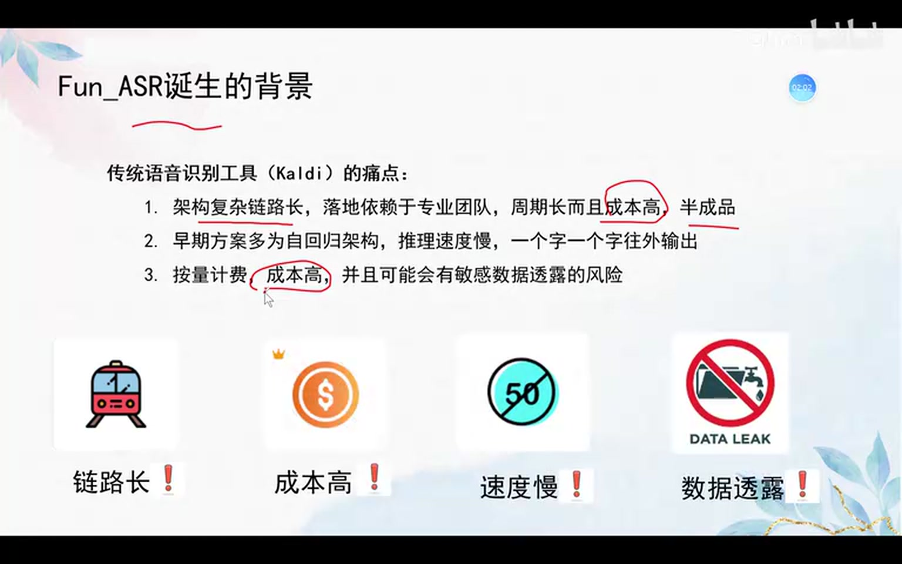

*▲ 视频原帧 k05 · 00:02:02　"链路长！成本高！数据泄露！"*

FunASR 给出的解法（视频第二部分）：

- 用**端到端**架构替代三段式，一个模型吃掉"语音 → 文字"；
- 用 **Paraformer 非自回归**替代自回归解码器，精度持平的前提下**推理快 5~10 倍**；
- **开源、可私有化部署**，数据不出内网，没有按量计费。

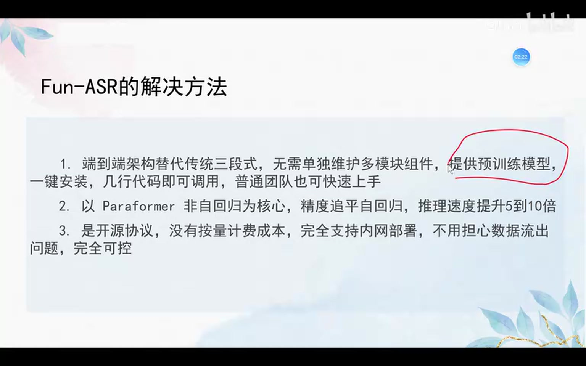

*▲ 视频原帧 k06 · 00:02:22　端到端 + 非自回归 + 开源私有化*

---

## 4. 解药：FunASR 与 Paraformer 到底是什么

- **FunASR**：阿里巴巴语音实验室（通义实验室 FunAudioLLM 团队）推出的**工业级开源端到端语音识别工具包**，2023 年正式开源。它不止"识别"一件事——VAD（语音端点检测）、标点恢复、时间戳、说话人分离、多语种识别，全都打包在内，是"开箱即用"的全链路套件。
- **Paraformer**：FunASR 的**核心技术底座**，非自回归（NAR）端到端 ASR 模型。2022 年 6 月发表（arXiv:2206.08317，Interspeech 2022），首次让"非自回归"达到工业级精度——论文口径是"与自回归 Transformer 精度相当、速度提升 10 倍以上"（原文：more than 10x speedup），FunASR 官方工程口径通常写"5~10 倍"。

视频给出的五个卖点（可当作选型 checklist）：

| 维度 | 卖点 | 含义 |
|---|---|---|
| 性能 | 非自回归，精度持平，速度提升 5~10 倍 | 一次并行出字，而非逐字生成 |
| 功能 | 全链路原生集成 | VAD、标点、时间戳、说话人一体 |
| 部署 | 多端多模式适配 | 服务端 / 边缘 / 流式都能用 |
| 合规 | 私有化内网部署 | 数据全程可控、可审计 |
| 生态 | 多语言多方言 + 热词定制 | 支持持续迭代 |

时间线（视频口径，与公开资料核对后基本一致）：

- **2022-06**：Paraformer 论文发布——CIF（连续积分发放）预测器 + Glancing LM 采样器 + MWER 训练，两大创新让非自回归达到工业精度；
- **2023**：全链路语音能力封装为 FunASR 工具包正式开源（FunASR 论文 arXiv:2305.11013，同年发表于 Interspeech 2023）；
- **2024-01**：FunASR v1.0 正式版，内置 VAD / 标点 / 时间戳 / 说话人分离，成为可直接生产的方案；
- **2024 至今**：推出大模型版本，并入 FunAudioLLM 语音大模型体系，从"纯声学转写"走向"语义级语音理解"。

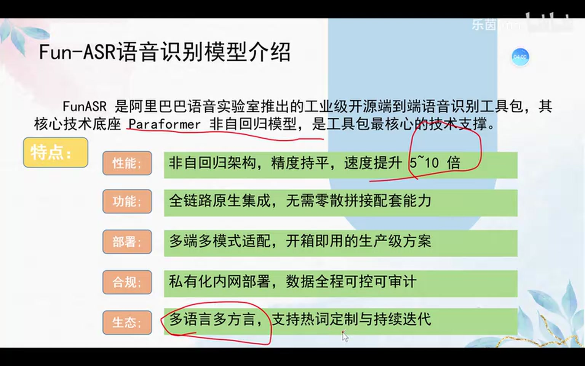

*▲ 视频原帧 k08 · 00:04:00　FunASR = 工业级开源端到端工具包，Paraformer 是它的底座*

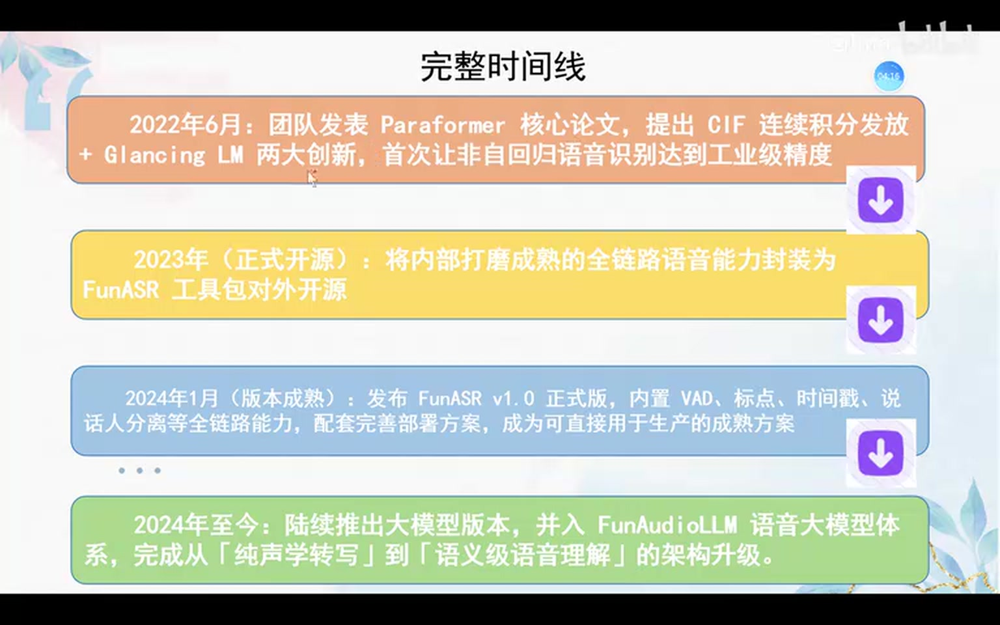

*▲ 视频原帧 k10 · 00:04:16　2022 论文 → 2023 开源 → 2024 v1.0 → 大模型时代*

---

## 5. 原理一：波形 → 梅尔谱，把声音变成一张可以计算的"照片"

这是全链路最被低估、却最关键的一步——**"特征工程"决定了模型的上限**。

### 5.1 为什么要先分帧

1 秒的语音，原始波形是 1 万多个采样点（16kHz 采样率），信息太碎，神经网络没法直接"看懂"振动曲线。但人耳听音时是"分段感知"的——20ms 左右的变化可以近似认为平稳，于是：

1. **分帧**：把 1 秒切成 50 段，每段 20ms，每段叫一"帧"（视频口径）；
2. **加窗**：工程上每帧还要乘一个窗函数（如 Hamming 窗），避免截断效应，这一步视频省略了，但真实系统都做；
3. **FFT 频域变换**：每一帧不再看波形，而是算出"低音、中音、高音"各自的能量分布；
4. **梅尔刻度加权**：按人耳听觉敏感度重新划分频带——人耳对低频敏感，低频划得细；对高频不敏感，高频划得粗。80 个频带 → 每帧 80 个数字；
5. **产出**：50 帧 × 80 维的矩阵，即 **50×80 的梅尔特征图**。

> **口径修正**：视频为了讲解方便按"1 秒 50 帧（20ms 一帧）"算。工业默认帧移是 10ms（每秒 100 帧）、帧长 25ms；FunASR 一线配置是 16kHz、80 维 fbank。原理完全一致，只是数字密度不同。

### 5.2 为什么是"梅尔"而不是普通频谱

梅尔刻度是仿照人耳等响曲线做的非线性频率映射（经典公式 `mel = 2595 × log10(1 + f/700)`，f 为 Hz）。它把"人耳觉得差不多响的两个频率"拉近，把"人耳敏感的低频"拉开——这样模型学出来的特征，天然更接近人类听觉系统的"关注点"。这也是为什么 ASR 几十年都绕不开它。


*▲ 图 2 自绘。四步链路全景：每一步解决一种"信息形态"问题*

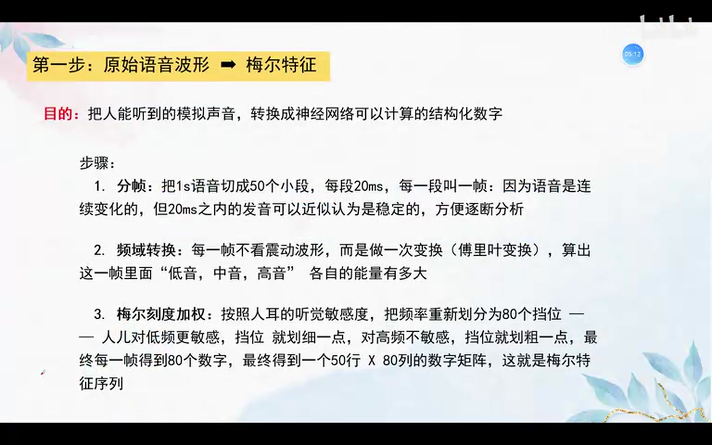

*▲ 视频原帧 k13 · 00:05:12　50 帧 × 80 维：把 1 秒声音摊平成一张"数字照片"*

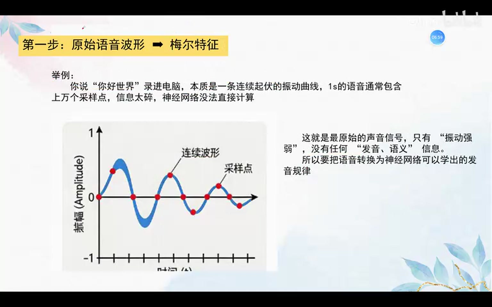

*▲ 视频原帧 k14 · 00:06:58　1 秒语音上万个采样点，信息太碎，必须"降维"*

---

## 6. 原理二：梅尔谱 → 深层声学特征，CNN 抠细节、注意力抓全局

拿到 50×80 的矩阵之后，模型要从中提炼两类信息：**发音细节**（"这个音到底发得准不准"）和**上下文语义**（"这个音在句子里应该是什么字"）。

视频的核心叙述是 **Conformer = CNN + Transformer 自注意力**，两者各司其职（Conformer 出处：arXiv:2005.08100，2020）。

### 6.1 CNN：用"发音模板"抠局部细节

- 卷积核 = 一堆**发音特征模板**：一层 CNN 里有几百个核，有的专管鼻音 n/m，有的专管爆破音 b/p，有的专管元音 a/i/u；
- 卷积核在梅尔图上从左到右**逐帧滑动**，每到一个位置就和当前时频区域做"相似度计算"——越像模板对应的发音模式，输出值越大；完全不匹配就接近 0；
- 局限：**局部感受野**。每个卷积核只看前后几帧（比如 3 帧），看不到整句话，没法结合上下文判断同音字。

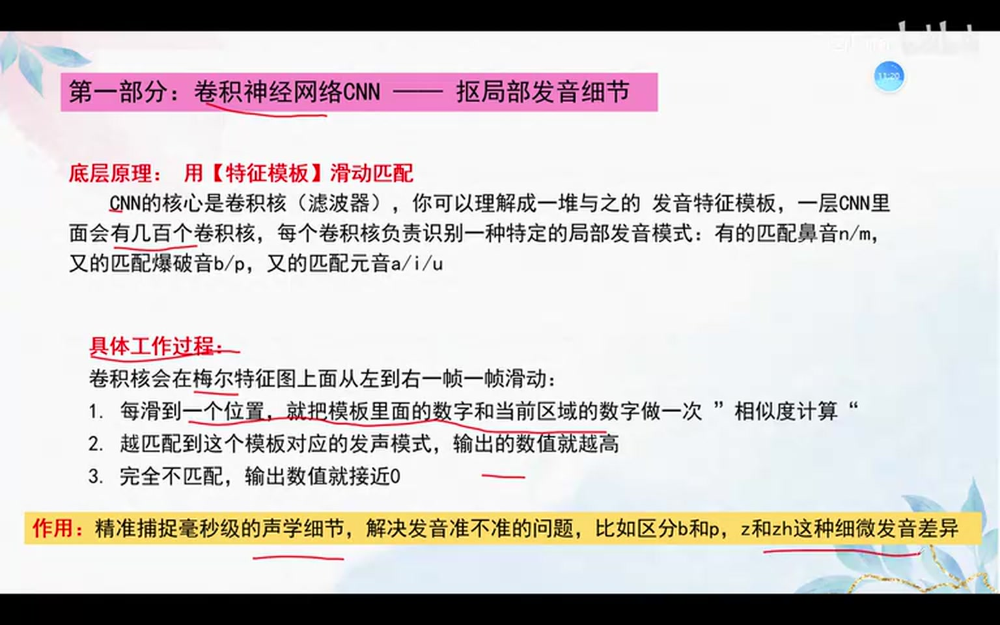

*▲ 视频原帧 k25 · 00:11:20　卷积核 = 发音特征模板，滑动匹配局部时频区域*

### 6.2 自注意力：让每个位置"参考全句"

自注意力（Self-Attention）解决 CNN 的视野局限：每个位置的特征不能只看自己，还要参考句子里所有相关位置。视频用 **Q / K / V** 解释得很清楚：

- **Q**（Query，搜索关键词）：当前位置想找什么；
- **K**（Key，身份标签）：每个位置自带的"身份证"；
- **V**（Value，内容）：每个位置携带的具体信息；
- 计算：Q 与所有 K 算相似度 → softmax 归一化成权重 → 对所有 V 加权求和 → 得到当前位置的新特征。

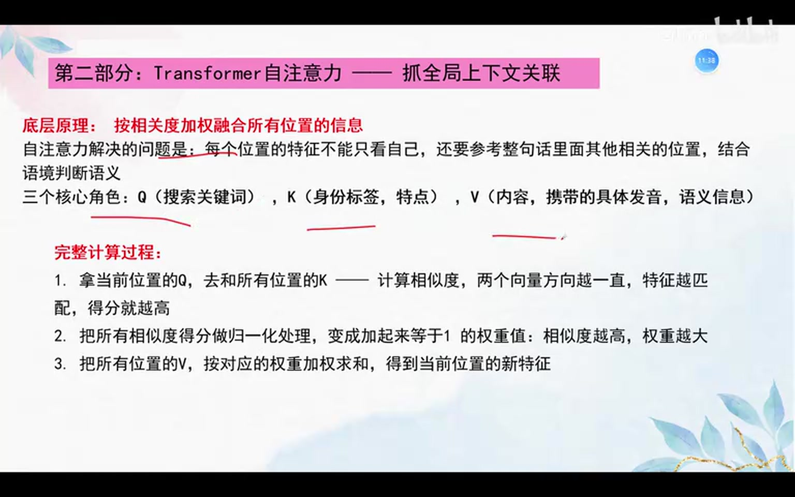

*▲ 视频原帧 k27 · 00:11:38　QKV：按相关度加权融合所有位置的信息*

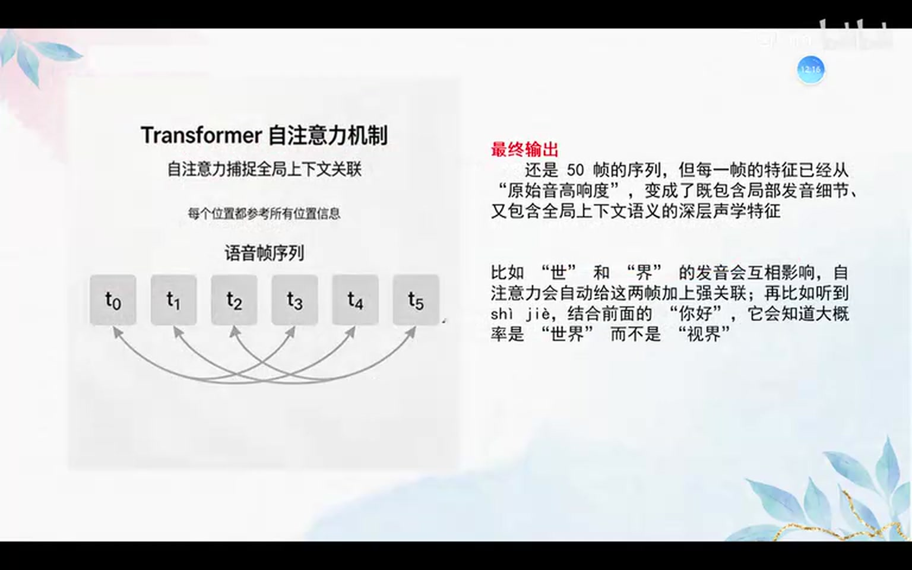

*▲ 视频原帧 k28 · 00:12:16　还是 50 帧，但每帧已从"音高响度"升级为"含全局语义的声学特征"*

### 6.3 双通道消歧："世界"还是"视界"？

这是全片最精彩的动画，也是理解"语义先验为什么重要"的关键例子：

- **纯声学**：CNN 算出来"世"的声学匹配度 0.45、"视"是 0.43——只差 0.02，靠听几乎拿不准；
- **语义**：加入自注意力后，"shi"位置会参考后面"jie"的信息——"世界"是高频搭配（语义关联权重 0.6），"视界"虽正确但书面（0.05）；
- **相乘**：世界 0.45×0.6 = **0.27**，视界 0.43×0.05 = **0.0215**，模型选"世界"。

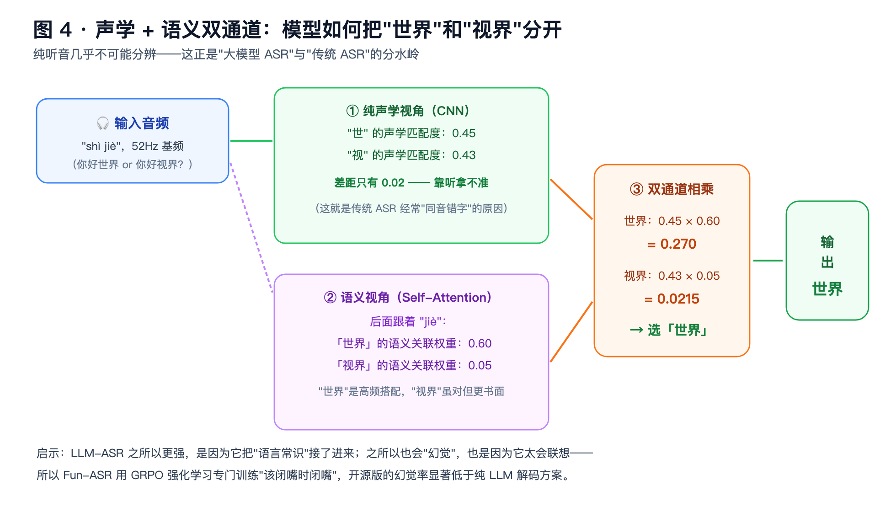

*▲ 图 4 自绘。这组"①纯声学 × ②语义权重"的双通道设计，正是"LLM-ASR 比纯声学强"的直观来源*

> **为什么这个例子值得反复讲**：它解释了"大模型 ASR"的两个面——**能结合语言常识猜对同音字**，也**可能因为太会联想而"听岔"**（幻觉）。2025 年的 Fun-ASR 大模型正是为此专门用强化学习训练"该闭嘴时闭嘴"（第 10 节展开）。

---

## 7. 原理三：长声学序列 → 短语义块，解决"50 帧对 4 个字"的长度矛盾

编码器输出了 50 帧声学特征，但"你好世界"只有 4 个字。**如何把长序列压成和文字数量一样多的单元——这就是"对齐"问题**，而且它是"非自回归"能否成立的前提。

### 7.1 方案一：CTC（连接时序分类）

- 规则：给 50 帧的**每一帧**都单独预测一个结果（某个字 / 音素 / 空白符 blank）；
- 整理：① 连续重复的字合并保留一个；② 所有空白符删掉；
- 例子：`你你你你-好好-世-界界` → 合并重复 → `你好世界`；
- 缺点：每帧独立预测，**先预测、后合并，信息损耗大**，同音字错、串字多，通常要外挂语言模型纠正。

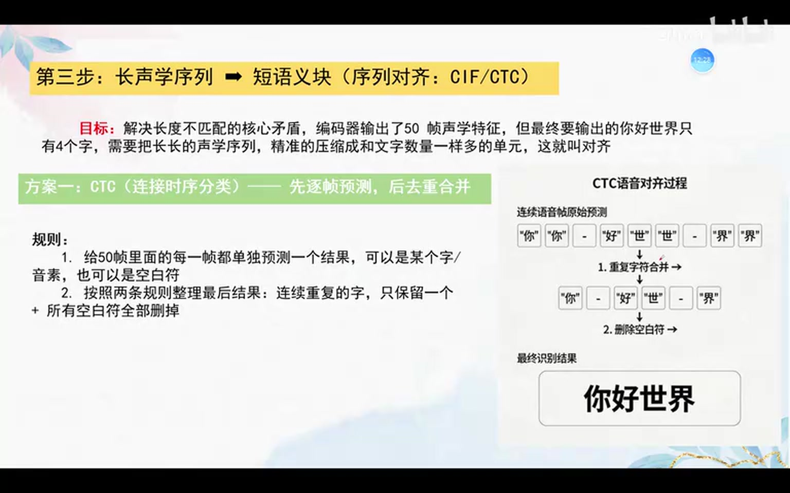

*▲ 视频原帧 k30 · 00:12:28　CTC：逐帧预测 + 合并重复 + 删除空白*

### 7.2 方案二：CIF（连续积分发放）——Paraformer 的核心

CIF（Continuous Integrate-and-Fire）是视频 Part THREE 的重头戏，也是 Paraformer 的灵魂：

1. 设一个**积分阈值**（如 1），积分计数器从 0 开始；
2. 从第一帧开始，一帧一帧把"这一帧的信息量"加进积分；
3. 当积分 ≥ 1 时，**发放一个语义块**（对应一个字），超出 1 的剩余积分滚存进下一轮；
4. 50 帧全部处理完，刚好发放 4 个语义块——正好对应"你好世界"四个字。

和 CTC 的本质区别：**CTC 是"先预测、后合并"（硬对齐），CIF 是"先融合多帧信息、攒够再分块"（软对齐）**——每个语义块都包含完整的多帧信息，质量更高，这就是"非自回归能一次性输出整句"的核心保障。

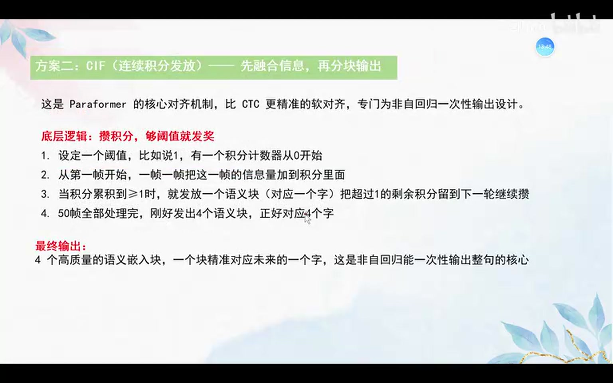

*▲ 视频原帧 k34 · 00:13:48　积分累加器：信息量攒到阈值才发放一个语义块*

---

## 8. 原理四：语义块 → 文字，非自回归解码与 Glancing LM

拿到了 4 个语义块，最后一步是"块 → 字"。视频用**自回归 vs 非自回归**的对决收尾，这一节也是理解 FunASR"为什么快"的钥匙：

| 维度 | 自回归（AR） | 非自回归（NAR） |
|---|---|---|
| 生成方式 | 逐字生成，第 n 个字依赖前 n-1 个字 | 所有字**并行**生成，一步出整句 |
| 类比 | 普通人听写，一笔一笔写，写到后面会回头看前面保证通顺 | 天才速记员，听完一句，脑子里直接浮现整句，一口气写完 |
| 优点 | 语义连贯性好 | 速度极快，延迟几乎与句长无关，工业部署成本低 |
| 缺点 | 慢，句子越长越慢，GPU 并行差 | 字与字互不参考，容易不通顺、同音字选错 |

Paraformer 的解法不是"硬上 NAR"，而是三道保险：

1. **CIF 预测器**：先准确预测输出长度并提取隐藏变量（上一节）；
2. **Glancing LM**：训练时让一个轻量语言模型"随机瞥见"部分正确 token，生成语义嵌入来增强 NAR 解码器对上下文依赖的建模——相当于给"互不参考"的字补上语境；
3. **双向解码器**：每个位置同时看到左右所有语义块；再加上 MWER（最小词错率）负样本训练，NAR 的精度被拉到与 AR 持平。

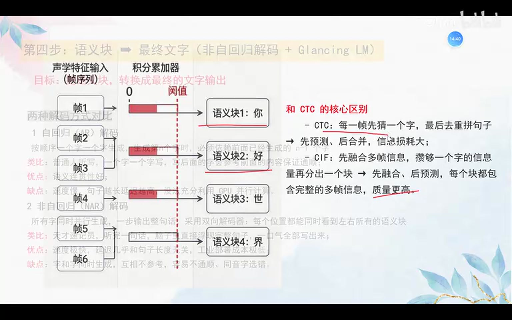

*▲ 视频原帧 k36 · 00:14:40　两种解码方式对比：AR 逐字 vs NAR 并行*

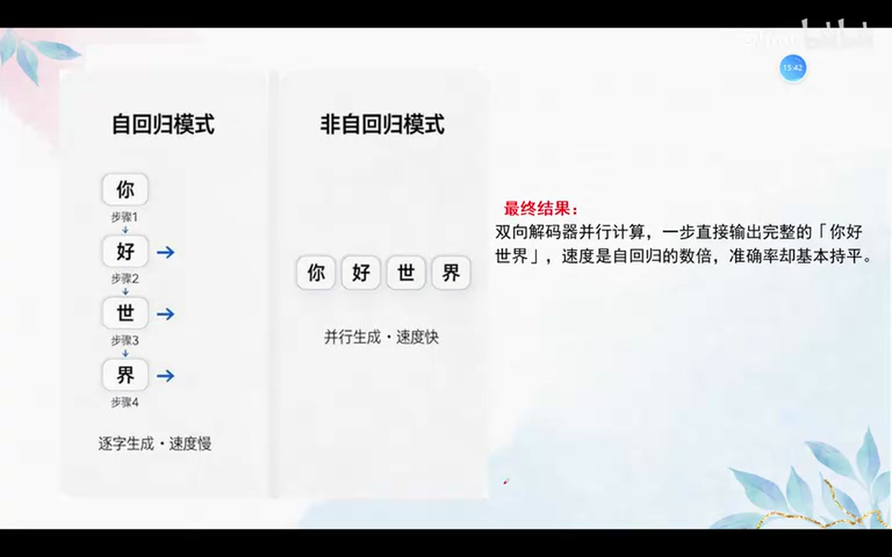

*▲ 视频原帧 k38 · 00:15:42　非自回归一步输出"你好世界"，速度是自回归的数倍、准确率基本持平*

---

## 9. 视频结论，以及这个结论的边界

视频 PART FOUR 的总结，可以压缩成一句话：

> **FunASR 的核心贡献，是打破了传统语音识别"高精度"与"高延迟"不可兼得的痛点：用 Paraformer 的非自回归架构解决速度瓶颈，再用模块化的全链路协同解决场景通用性问题。**

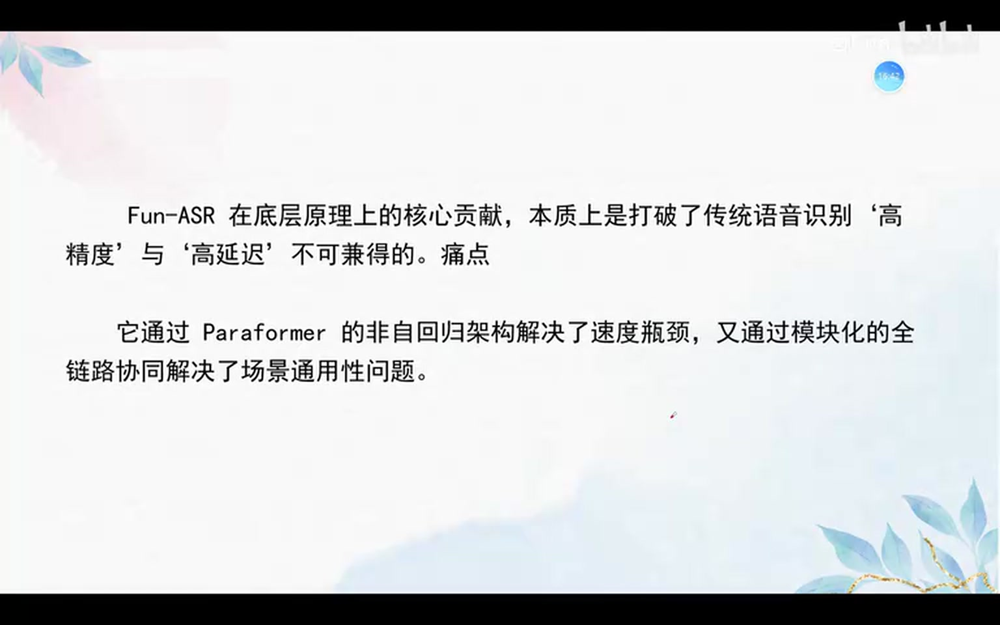

*▲ 视频原帧 k57 · 00:16:42　"高精度与高延迟不可兼得"被打破*

这个结论**成立，但只属于它的时代**。需要清醒的三点：

1. **它是"工具包时代"的结论**。FunASR 的强项是"工程化、全链路、非自回归"，但 2025 年之后，开源大模型（SenseVoice、Fun-ASR-Nano）与原生多模态模型（Qwen 系列）又把"语义理解"往前推了一代——第 10 节展开。
2. **"速度 5~10 倍"有条件**。论文口径是与自回归 Transformer 相比（arXiv:2206.08317 原文：over 10x speedup），官方工程口径写 5~10 倍；实际收益取决于硬件、batch、流式设置，务必自己压测。
3. **"精度持平"是基准层面**。开源基准集（AISHELL-1 等）上 NAR 确实持平，但在**真实工业场景**（远场、方言、歌词、中英混说）下，各类模型差距会重新拉开——Fun-ASR 技术报告专门用"工业测试集"证明了这一点（Whisper-large-v3 在工业集上平均 WER 高达 33.39，而在开源基准上只有 4~6）。

---

## 10. 视频之外：2026 的主流答案——LLM-ASR 与原生多模态

视频讲述的是 2022–2024 年的 FunASR 路线。而 2025 年底，同一团队交付了新一代 **Fun-ASR-Nano-2512**（与视频同名但路线不同）：**把"语言大模型"直接装进 ASR 的解码器**。理解它，你就理解了当下开源语音的最前沿。

### 10.1 Fun-ASR-Nano 长什么样

- **骨架**：音频编码器（Transformer，Nano 版 0.2B）+ 音频适配器（2 层 Transformer）+ **CTC 解码器**（跑在编码器上，给热词纠错提供"底稿"）+ **LLM 解码器**（Nano 版 0.6B）；
- **两档规模**：Fun-ASR-nano（0.8B，开源）与 Fun-ASR（7.7B，内部版）；同一套架构，只换宽度；
- **数据**：预训练约**数千万小时**真实语音（含无标注音频与带标注语音），SFT 约**数百万小时**；
- **三阶段训练**：① Best-RQ 自监督预训练，且**用 Qwen3 文本 LLM 的权重初始化编码器**（跨模态初始化，收敛更快、表征更接近语言）；② AED 框架的监督预训练 + SFT（噪声 / 方言 / TTS / 模拟流式 / 热词数据全上）；③ **GRPO 强化学习**——奖励"识别得准、且该闭嘴时闭嘴"，专门治 LLM 的**幻觉**；
- **能力面**：中文含 7 大方言 + 26 种口音；Fun-ASR-MLT 版覆盖 31 种语言；远场高噪声、中英代码切换、歌词/说唱识别、热词定制、**流式**低延迟。

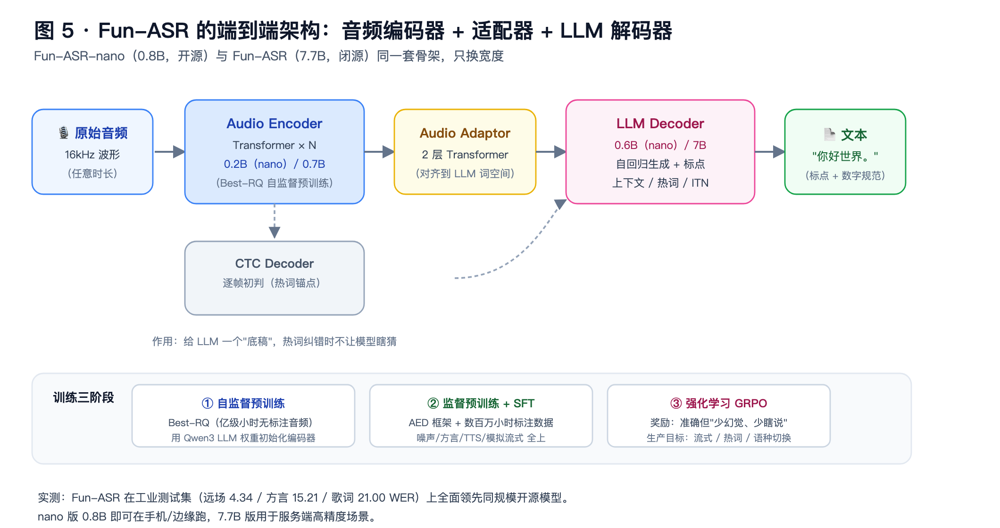

*▲ 图 5 自绘。Fun-ASR-nano（0.8B）与 Fun-ASR（7.7B）同一骨架：编码器 → 适配器 → LLM 解码器，旁挂 CTC 解码器*

### 10.2 数据说话：开源基准 vs 工业真实场景

Fun-ASR 技术报告（arXiv:2509.12508）给出的工业测试集 WER 对比（越低越好）：

| 模型 | 参数量 | 开源 | 工业集平均 WER | 方言 WER | 远场 WER | 歌词 WER |
|---|---|---|---|---|---|---|
| Whisper-large-v3 | 1.6B | ✅ | **33.39** | 66.14 | 22.21 | 54.82 |
| Paraformer v2 | 0.2B | ✅ | 23.49 | 41.16 | 9.55 | 50.14 |
| Kimi-Audio | 8B | ✅ | 31.00 | 71.94 | 10.95 | 65.18 |
| Seed-ASR | — | ❌ | 15.95 | 29.45 | 4.59 | 30.26 |
| **Fun-ASR-nano** | **0.8B** | ✅ | **16.72** | **28.18** | **5.79** | **30.85** |
| **Fun-ASR** | **7.7B** | ❌ | **12.70** | **15.21** | **4.34** | **21.00** |

两个结论值得记住：

1. **开源基准会"骗人"**：Whisper-large-v3 在 LibriSpeech 上 WER 只有 1.86/3.43，到了真实工业场景平均 33.39——开源基准集分布太"干净"。
2. **"大模型 ASR" 是真的跨代**：Fun-ASR-nano 只有 0.8B，工业集平均 16.72，远优于 8B 的 Kimi-Audio（31.00）和 Whisper（33.39）；方言场景尤其明显（28.18 vs 66.14）。

### 10.3 与视频路线的"父子关系"

| | FunASR 工具包时代（视频讲的） | Fun-ASR 大模型（2025-12 起） |
|---|---|---|
| 解码方式 | 非自回归（CIF 语义块 + 并行解码） | LLM 解码（自回归）+ CTC 辅助 |
| 语言知识 | 轻量 LM（Glancing LM 训练时用） | 完整 LLM 词空间 + 上下文 + RL |
| 速度 | 极快（一次并行出字） | 流式友好，但相对慢一些 |
| 精度天花板 | 工业基准持平 AR | 工业场景显著超过 AR |
| 解决的核心问题 | 工程化 + 速度 | 语义理解 + 幻觉治理 + 长尾场景 |

**一句话：视频讲的是"怎么把 ASR 做快、做便宜"；2025 年之后的主线是"怎么把 ASR 做准、做得懂上下文"。**

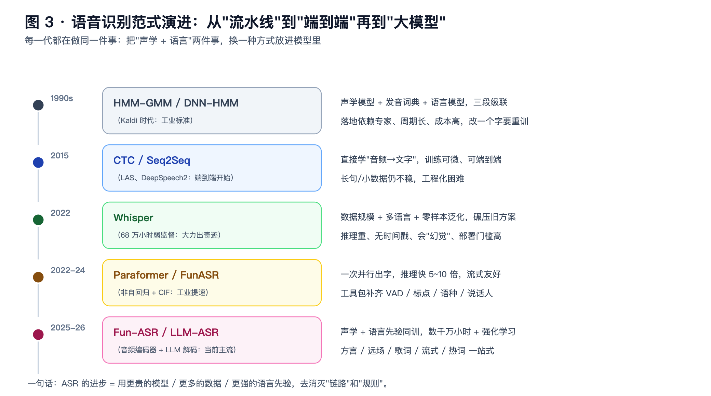

*▲ 图 3 自绘。1990s HMM-GMM → 2015 端到端 → 2022 Whisper → 2022-24 Paraformer/FunASR → 2025-26 LLM-ASR*

---

## 11. 从语音到全模态：三条路线与一张全景图

把镜头拉远，语音只是多模态的一个切面。2026 年，工业界在多模态语音上其实有**三条并行路线**：

| 路线 | 做法 | 代表 | 适合 |
|---|---|---|---|
| ① 级联 | ASR 出文字 → LLM 纠错/润色/翻译 | Whisper + 后处理；多数商业 API | 预算敏感、要稳、要可插拔 |
| ② 半级联 / LLM-ASR | 音频编码器 → 适配器 → LLM 解码器，一步出终稿 | Fun-ASR-nano、Seed-ASR、FireRed-ASR、SenseVoice | 要"懂"、要上下文、要方言热词 |
| ③ 原生全模态 | 一个 Transformer 同时吃音频/图像/文本/视频 | Qwen-Omni 系列、GPT-4o 级系统 | 全模态对话、跨模态推理 |

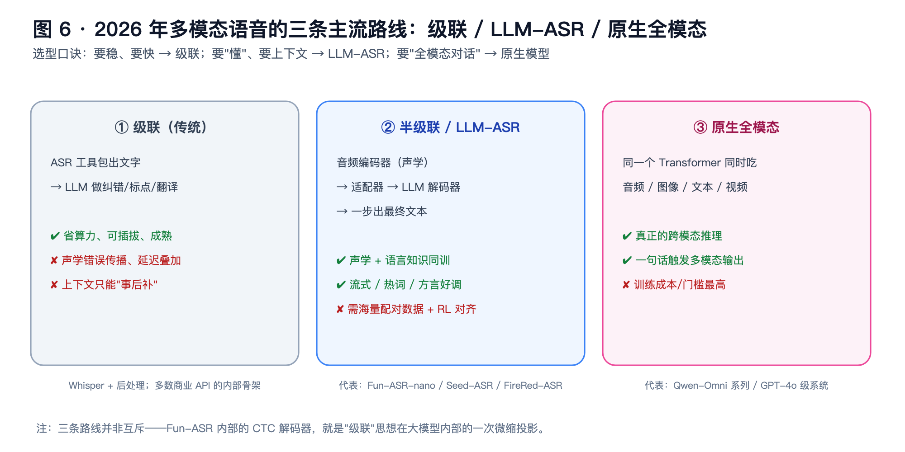

*▲ 图 6 自绘。三条路线并非互斥：Fun-ASR 内部的 CTC 解码器，就是"级联"思想在大模型内部的一次微缩投影*

**选型口诀**：要稳、要快 → 级联；要"懂"、要上下文 → LLM-ASR；要"全模态对话" → 原生全模态模型。

而三者背后，是同一张多模态地图（回到图 1）：**模态特化编码器（梅尔+CNN / ViT / tokenizer）+ 对齐层（投影/跨模态注意力）+ 融合层（LLM）+ 生成层（自回归/非自回归）**。语音识别之所以是"最小切口"，是因为它的编码器与解码器都简单到可以用一节原理课讲完；而视觉、视频只需要把编码器换成 ViT、把对齐换成 patch 与时间位置的联合编码——四步地图不变。

---

## 12. 动手：两套最小可跑示例

### 12.1 用 FunASR 工具包跑 Paraformer（视频路线）

```python
# pip install funasr modelscope torch
from funasr import AutoModel

model = AutoModel(
    model="paraformer-zh",          # 非自回归，CIF + Glancing LM
    vad_model="fsmn-vad",           # 端点检测
    punc_model="ct-punc",           # 标点恢复
)

res = model.generate(input="audio.wav", batch_size_s=300)
print(res[0]["text"])
```

### 12.2 用 Fun-ASR-Nano 跑 LLM-ASR（2025 路线）

```python
# pip install funasr torch（模型会自动下载到缓存目录）
from funasr import AutoModel

model = AutoModel(
    model="FunAudioLLM/Fun-ASR-Nano-2512",
    hub="hf",                # 或 modelscope
    trust_remote_code=True,
    vad_model="funasr/fsmn-vad",
    vad_kwargs={"max_single_segment_time": 30000},
)
res = model.generate(
    input=["demo.wav"],
    cache={},
    batch_size=1,
    hotwords=["开放时间"],   # 热词定制：领域术语 / 人名
    language="中文",
    itn=True,                 # 逆文本规范化：一二三 → 123
)
print(res[0]["text"])
```

> 两个示例都只是"调用"。要在生产环境跑，真正的工作量在：音频前处理（降噪/重采样）、说话人分离、流式切片、热词库维护、WER 评测集构建——这些都不在 18 分钟视频里。

---

## 13. 尽职调查清单：视频没讲、但部署前必须知道的坑

把这篇教程当"照做就上线"就错了。以下是上线前必须自己验证的清单：

- [ ] **"5~10 倍"是相对谁**？相对 AR Transformer 基线、特定 batch/硬件。你的场景（流式？长音频？低算力？）可能收益完全不同。
- [ ] **"精度持平"是哪个集**？开源基准 ≠ 你的业务数据。用你们的真实音频构建 200~500 条评测集，先测再信。
- [ ] **幻觉**：LLM 解码器越强越会"脑补"。Fun-ASR 用 GRPO 抑制幻觉，但任何模型都可能空耳——音频静音/音乐段尤其要测。
- [ ] **方言/口音/歌词**：官方数字是 7 方言 + 26 口音，但你们用户的口音可能不在其中；歌词 WER 普遍仍在 20~30%。
- [ ] **"开源私有化"≠零成本**：GPU 推理、模型更新、服务治理、监控告警都是成本项，先算 TCO 再谈"省钱"。
- [ ] **时间戳/说话人**：Fun-ASR-Nano 的 TODO 里还写着"支持返回时间戳""支持区分说话人"——如果你的场景强依赖逐句时间轴，先选带这些能力的版本（如 FunASR 工具包）。
- [ ] **数字口径**：视频中"93% 识别准确率""5~10 倍"等宣传数字，建议回查官方 README 与论文表格，按同口径对比。

---

## 14. 术语表

| 术语 | 一句话解释 |
|---|---|
| ASR | Automatic Speech Recognition，自动语音识别 |
| 梅尔谱 / fbank | 按人耳听觉特性重排频带后的语谱图特征，ASR 的标准输入 |
| 帧（frame） | 语音分帧的最小单位，通常 20~25ms 一帧、10~20ms 帧移 |
| CNN / 卷积核 | 在时频图上滑动匹配的"发音模板"，负责局部细节 |
| 自注意力 / QKV | 让每个位置参考全句信息的机制，QKV 是它的三个角色 |
| Conformer | CNN + Transformer 混合的语音编码器（arXiv:2005.08100） |
| CTC | 逐帧预测 + 合并重复 + 删除 blank 的对齐方式 |
| CIF | 连续积分发放：攒够信息量才发放一个语义块，Paraformer 核心 |
| AR / NAR | 自回归（逐字生成）/ 非自回归（并行一次生成） |
| Glancing LM | 训练时"瞥见"部分正确 token 的轻量语言模型，提升 NAR 连贯性 |
| LLM-ASR | 把 LLM 作为解码器的端到端语音大模型（Fun-ASR-Nano、Seed-ASR 等） |
| GRPO | 一种强化学习算法，Fun-ASR 用它抑制幻觉 |
| Best-RQ | 自监督语音预训练框架，Fun-ASR 用它预训练音频编码器 |
| 全模态 | 同一模型理解/生成多种模态（音频、视觉、文本、视频） |

---

## 15. 参考与延伸

- 视频原片：B 站 BV1XAbd6SEnJ《语音识别天花板？一期视频讲透 Fun-ASR 的诞生与核心原理》（2026-08）
- Fun-ASR Technical Report（arXiv:2509.12508，v4 2025-12）
- Fun-ASR-Nano-2512 模型页：HuggingFace / ModelScope「FunAudioLLM/Fun-ASR-Nano-2512」
- Paraformer：arXiv:2206.08317（Interspeech 2022）
- Conformer：arXiv:2005.08100
- FunASR 工具包论文：arXiv:2305.11013；GitHub: modelscope/FunASR
- Whisper：arXiv:2212.04356
- Qwen2.5-Omni / Qwen-Omni 系列：阿里通义实验室，原生全模态路线

> **免责声明**：本文是学习笔记与原理拆解，不是官方文档；文中模型效果数据来自官方论文/README 的公开表格，复现口径以官方为准。视频原帧用于学习对照，版权归原作者所有。
